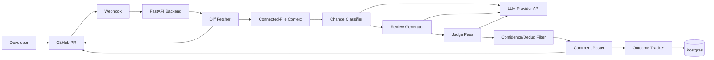

# High-Level Design (HLD)

## Architecture

## Components

Status is as built, not as planned.

| Component | Responsibility | Lives in | Status |
|---|---|---|---|
| FastAPI backend | Webhook receipt, signature verification, idempotency | `src/webhooks/` | built |
| GitHub client | App JWT, installation token, pagination, posting | `src/github/` | built |
| Diff ingestion | Changed files, skip rules, hunks and line numbers | `src/diff/` | built |
| Connected-File Context | Snapshot, changed symbols, verified references, ranked bundle | `src/context/` | built |
| Change Classifier | Tags each change; path rules first, one batched model call for the rest | `src/classification/` | built |
| Review Generator | Structured findings, different questions per change kind | `src/review/` | built |
| Judge Pass | Verifies each finding against the code; three-way verdict (ADR-007) | `src/judge/` | built |
| Severity/Confidence Gate | Holds back low severity and low confidence | `src/filter/` | built |
| Comment Poster | One batched review, inline comments by line and side | `src/github/review.py` | built |
| Outcome Tracker | Records resolved and reopened comment threads | `src/outcomes/` | built, not yet exercised on a real thread |
| Evaluation harness | Replays labelled pull requests, scores, runs ablations | `src/eval/` | built |
| Deployment | Somewhere GitHub can reach without a laptop | — | **not started** |

### Known limitations, measured

- **Connected-file context finds callers of changed functions, not consumers of changed data shapes.** A pull request renaming a dictionary key broke three files, none of which were retrieved, because the consumers reference a string literal rather than a function name.
- **No recovery for interrupted reviews.** A crash during `processing` leaves the row there. The `(status, updated_at)` index exists for the scan that would fix it; the scan is unwritten.
- **A delivery that arrives while the service is down is lost.** GitHub does not retry.
- **Findings are not deduplicated across re-reviews.** Pushing twice posts the comments twice.
- **One language.** Every tree-sitter query assumes Python.

## End-to-End Data Flow
1. Developer opens or updates a pull request.
2. GitHub sends a `pull_request` webhook.
3. The endpoint verifies the signature, records the delivery, claims the commit, and replies — all before any slow work, because GitHub allows ten seconds and never retries.
4. The pipeline fetches changed files and skips lockfiles, vendored code and generated output.
5. Connected-File Context downloads the repository at the reviewed commit, resolves which functions changed, and finds verified references to them elsewhere.
6. The Change Classifier tags each file. Path rules settle tests, migrations, dependency files, docs and config with no model request.
7. The Review Generator produces structured findings, one request per change kind.
8. The Judge verifies each finding against the code, keeping those it cannot check with reduced confidence.
9. The gate holds back low-severity and low-confidence findings. All findings are stored regardless (ADR-010).
10. The Comment Poster submits one batched review, then fetches the comment ids GitHub omits from the create response.
11. The Outcome Tracker records thread resolution against those ids.

The pipeline takes a pull request and a review id, never an HTTP request. That is what lets the evaluation harness replay historical pull requests with no webhook involved.

## Scalability
Single FastAPI service is sufficient at student-project scale. If review volume grew, the natural next step is a queue between webhook receipt and pipeline processing so GitHub's webhook delivery isn't blocked on LLM latency — not warranted at v1 scale.

## Reliability
- Timeouts on all LLM/GitHub API calls.
- Retry transient LLM failures once before failing the review gracefully.
- Skip (not crash on) binary files, lockfiles, and empty diffs.
- A failed review should not leave partial/duplicate comments on the PR.

## Security
- GitHub App permissions: PR read/write, contents read — nothing else.
- Webhook signature verification on every request.
- No code execution from PR content — static analysis only.
