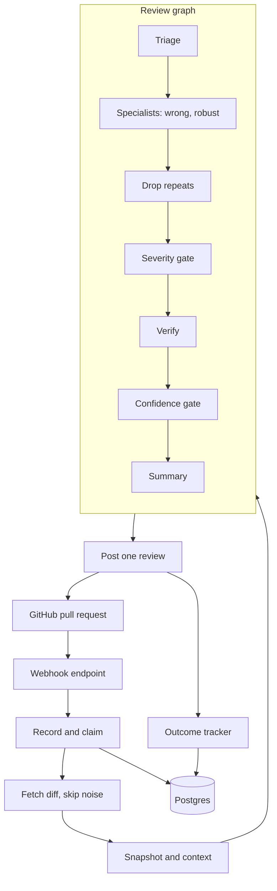

# High-Level Design

The service reviews a pull request and posts inline comments on it. It runs
as one FastAPI process, stores everything in Postgres, and reaches a model
through an OpenAI-compatible API.

## Architecture

## Components

| Component | Responsibility | Lives in |
|---|---|---|
| Webhook endpoint | Signature check, idempotency, claiming a commit | `src/webhooks/` |
| Pipeline | Records, runs the review, posts, records what posted | `src/pipeline/` |
| Review graph | The stages above, as a checkpointed LangGraph state graph | `src/pipeline/graph.py` |
| Diff ingestion | Changed files, skip rules, hunks and line numbers | `src/diff/` |
| Connected-file context | Snapshot, changed symbols, verified references, ranked bundle | `src/context/` |
| Classifier | Labels each file; path rules first, one batched model call for the rest | `src/classification/` |
| Agents | The tool loop, the toolbox, the specialist prompts, triage, summary | `src/agents/` |
| Judge | Verifies findings — one cheap call, or a tool loop for risky ones | `src/judge/` |
| Gates | Holds back low severity and low confidence; drops repeats | `src/filter/` |
| GitHub client | App JWT, installation tokens, pagination, posting | `src/github/` |
| Model client | HTTP, per-model token budgets, retries, tool-call parsing | `src/llm/` |
| Outcome tracker | Records resolved and reopened comment threads | `src/outcomes/` |
| Recovery | Picks up reviews interrupted by a restart | `src/recovery.py` |
| Evaluation harness | Replays labelled pull requests, scores, runs ablations | `src/evaluation/` |
| Deployment | Somewhere GitHub can reach without a laptop | **not built** |

## How one review runs

1. A developer opens or updates a pull request.
2. GitHub sends a `pull_request` webhook.
3. The endpoint verifies the signature, records the delivery, claims the
   commit, and replies. All of this happens before any slow work: GitHub
   allows ten seconds and never retries.
4. Claiming retires any unfinished review of an older commit on the same
   pull request, so a second push does not leave two reviews competing.
5. The pipeline fetches the changed files and skips lockfiles, vendored code
   and generated output.
6. The repository is downloaded at the reviewed commit. Changed symbols are
   resolved and verified references to them found elsewhere, each with a
   confidence score.
7. The classifier labels each file. Path rules settle tests, migrations,
   dependency files, docs and config with no model request.
8. Triage reads those labels and decides which specialists to wake. It makes
   no model call of its own.
9. Two specialists run concurrently, each a tool loop over the snapshot:
   **wrong** looks for correctness and security, **robust** for error
   handling and concurrency. Both start from the context of step 6 and may
   read files, grep, look up definitions, find references and list tests.
10. Findings already posted on an earlier commit are dropped before anything
    is spent verifying them.
11. The severity gate drops what could never be posted.
12. Verification: a high-severity or low-confidence finding gets its own tool
    loop, one per file. Everything else gets a single cheap call to a model
    from a different family.
13. The confidence gate decides what posts.
14. A summary is written, but only when something will post.
15. One batched review is submitted, then the comment ids GitHub omits from
    the create response are fetched.
16. The outcome tracker records thread resolution against those ids.

The pipeline takes a pull request and a review id, never an HTTP request.
That is what lets the evaluation harness replay historical pull requests with
no webhook involved.

`AGENTIC_PIPELINE=0` runs a single-pass alternative instead of steps 8–14:
one generation call and one judge call. Both produce the same `ReviewOutcome`
and can be pointed at the same evaluation cases, which is how the cost of the
agents is measured rather than assumed.

## Models

| Role | Model |
|---|---|
| Classification, specialists, summary | `openai/gpt-oss-120b` |
| Judge and verifier | `qwen/qwen3.8-27b` |

The verifier is deliberately a different family from the generator, because a
model asked to check its own work mostly agrees with itself.

## Known limitations

- **Connected-file context finds callers of changed functions, not consumers
  of changed data shapes.** A renamed dictionary key breaks files that
  reference a string literal, not a function name. The specialists' `grep`
  tool is what covers this case; the pre-built context does not.
- **A delivery that arrives while the service is down is lost.** GitHub does
  not retry.
- **Development and production share one database.** Separate test database,
  but a bad migration locally reaches real rows.
- **Not deployed.** The service only runs on a laptop.

## Scalability

One FastAPI process is enough at this scale. Review work runs as a background
task so the webhook reply is never blocked on model latency. If volume grew,
the next step is a queue between receipt and processing.

The binding constraint is not CPU but the model's tokens-per-minute budget,
which is why `src/llm/budget.py` reserves tokens per model before sending
rather than discovering the limit by being refused.

## Reliability

- Timeouts on every model and GitHub call; transient failures retried.
- A spent daily token budget fails immediately rather than retrying into
  silence.
- No database session is held across a review, which can take minutes.
- A review interrupted by a restart is found and resumed at the next start.
- Binary files, lockfiles and empty diffs are skipped, not crashed on.

## Security

- GitHub App permissions: pull requests read/write, contents read.
- Every webhook signature verified against the raw bytes.
- No code from a pull request is ever executed; analysis is static.
