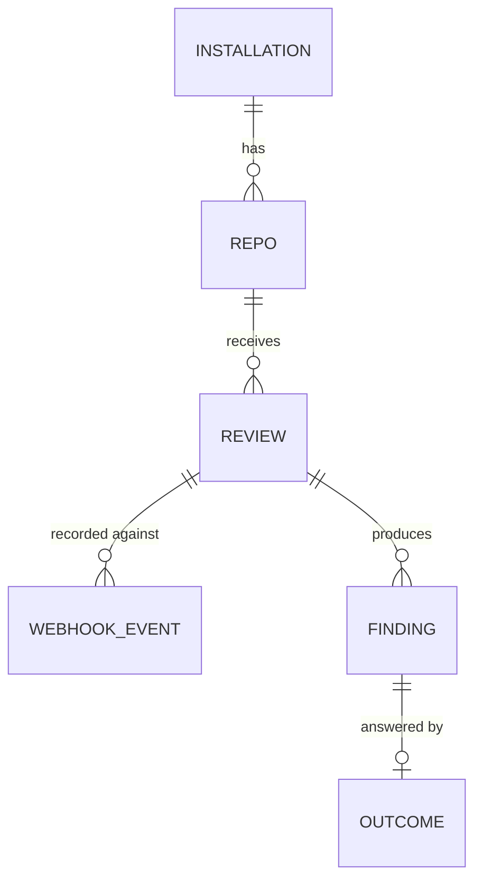

# Database Design

Six tables in Postgres. Every column below exists in `src/db/models.py`;
migrations are in `alembic/versions/`.

## Tables

### installations

Someone who installed the App on their account.

| Column | Type | Notes |
|---|---|---|
| `id` | integer | primary key |
| `github_installation_id` | bigint | **unique** — GitHub's id, what tokens are issued against |
| `account_login` | varchar(255) | |
| `installed_at` | timestamptz | |

### repos

| Column | Type | Notes |
|---|---|---|
| `id` | integer | primary key |
| `installation_id` | integer | → `installations.id` |
| `github_repo_id` | bigint | **unique** — matched on this, never the name |
| `full_name` | varchar(512) | `owner/repo`, refreshed on every event |
| `default_branch` | varchar(255) | |
| `created_at` | timestamptz | |

A repository can be renamed at any time; its id cannot change. Everything
keys on `github_repo_id`, and `full_name` is treated as a label.

### webhook_events

One row per authenticated delivery — including duplicates and ignored
actions — so every delivery is accounted for. A request that fails signature
verification is logged and never stored, so unauthenticated input does not
reach the database. The payload is not kept, only the fields that identify
the event.

| Column | Type | Notes |
|---|---|---|
| `id` | integer | primary key |
| `delivery_id` | varchar(64) | **unique** — the `X-GitHub-Delivery` GUID |
| `event` | varchar(64) | `pull_request`, `pull_request_review_thread` |
| `action` | varchar(64) | `opened`, `synchronize`, … |
| `github_repo_id` | bigint | nullable |
| `pr_number` | integer | nullable |
| `head_sha` | varchar(40) | nullable |
| `outcome` | varchar(16) | `accepted` / `duplicate` / `ignored`, checked |
| `review_id` | integer | nullable → `reviews.id` |
| `received_at` | timestamptz | |

### reviews

One row per unit of work: one commit on one pull request.

| Column | Type | Notes |
|---|---|---|
| `id` | integer | primary key |
| `repo_id` | integer | → `repos.id` |
| `pr_number` | integer | |
| `head_sha` | varchar(40) | the commit under review |
| `status` | varchar(32) | checked against the nine valid statuses |
| `attempts` | integer | runs started; caps automatic recovery |
| `error_code` | varchar(64) | nullable, set when `status = failed` |
| `context_status` | varchar(16) | nullable — `ok` / `degraded` / `unavailable` |
| `github_review_id` | bigint | nullable, set once GitHub accepts |
| `model_calls` | integer | nullable — what the review cost |
| `prompt_tokens` | integer | nullable |
| `completion_tokens` | integer | nullable |
| `seconds` | float | nullable |
| `created_at` | timestamptz | |
| `updated_at` | timestamptz | refreshed on every change; finds stuck reviews |

**`UNIQUE (repo_id, pr_number, head_sha)`** is the idempotency key. Claiming
is an insert against it, so two messages about one commit produce one review
and the loser is told nothing came back.

`context_status` records how good the connected-file context was, so a weak
review can be explained rather than guessed at afterwards.

### findings

Every finding is stored, including those the gates hold back, so thresholds
can be retuned without re-running the reviewer (ADR-010).

| Column | Type | Notes |
|---|---|---|
| `id` | integer | primary key |
| `review_id` | integer | → `reviews.id` |
| `file` | varchar(1024) | |
| `line` | integer | |
| `severity` | varchar(32) | |
| `category` | varchar(64) | |
| `message` | text | nullable — the sentence the developer actually read |
| `rationale` | text | |
| `confidence` | float | |
| `model` | varchar(128) | nullable — which model produced it |
| `prompt_version` | varchar(32) | nullable — a hash of the prompt text |
| `found_by` | varchar(32) | nullable — `wrong`, `robust` or `lint` |
| `posted` | boolean | |
| `github_comment_id` | bigint | nullable — how an outcome is matched back |

### outcomes

What the developer did with a comment. This is how the project measures
whether it is useful rather than merely finished.

| Column | Type | Notes |
|---|---|---|
| `id` | integer | primary key |
| `finding_id` | integer | → `findings.id` |
| `repo_id` | integer | → `repos.id` |
| `category` | varchar(64) | copied from the finding, so it can be grouped |
| `outcome` | varchar(16) | `accepted` / `rejected` / `ignored` |
| `recorded_at` | timestamptz | |

**`UNIQUE (finding_id)`** — one current outcome per finding. A thread can be
resolved and reopened, so the row is replaced rather than appended to.

## Relationships



## Indexes and constraints

| | Purpose |
|---|---|
| `installations.github_installation_id` unique | one row per installation |
| `repos.github_repo_id` unique | one row per repository |
| `webhook_events.delivery_id` unique | the same message twice |
| `uq_reviews_repo_pr_head` | two messages about the same commit |
| `uq_outcomes_finding` | one current outcome per finding |
| `ix_repos_installation_id` | repositories for an installation |
| `ix_reviews_repo_created` | a repository's review history |
| `ix_reviews_status_updated` | the stuck-review recovery scan |
| `ix_findings_review_id` | a review's findings |
| `ix_outcomes_repo_category` | acceptance rate per category, per repository |
| `ix_findings_model_prompt` | what each model and prompt version actually found |
| `ck_reviews_status` | rejects a status nothing understands |
| `ck_reviews_context_status` | same, for context quality |
| `ck_webhook_events_outcome` | same, for delivery outcome |

The check constraints exist so a typo is refused by the database rather than
stored and discovered later by something that cannot interpret it.

## Lifecycle

```
delivery recorded ──> commit claimed ──> review runs ──> findings stored
                            │                                  │
                      (or duplicate,                      gates decide
                       ignored, superseded)                     │
                                                          review posted
                                                                │
                                                       comment ids matched
                                                                │
                                                        outcome recorded
```

Findings are stored **before** posting, so a posting failure loses nothing.
`github_review_id` and `github_comment_id` are set only after GitHub accepts,
which is what lets an outcome be tied back to the finding that produced it.

## Known gaps

- **Development and production share one database.** The test database is
  separate and wiped on every run, which is why `conftest.py` refuses to
  start when `TEST_DATABASE_URL` matches `DATABASE_URL`.
- **Reviews 1–23 predate the provenance columns** and carry nulls there.
  Backfilling them with a guess would be worse than leaving them blank,
  which at least says "we did not record this".
- **A rejection is never stored.** GitHub reports a thread resolved or
  unresolved, and nothing else, so `outcomes` only ever holds `accepted`.
  Suppression works around it by taking the denominator from posted
  findings rather than from stored outcomes — see the product
  requirements, US-006.
