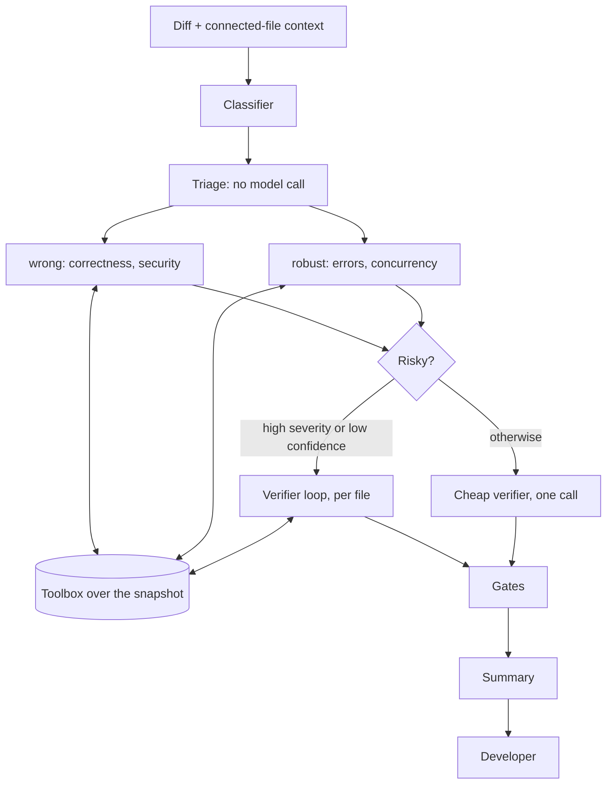

# Generative AI Architecture

## Why a model at all

Linters and SAST tools are the right answer for pattern-matched issues, and
cheaper than anything here. A model earns its place only on the judgements
they cannot make: whether a new parameter is handled everywhere it reaches,
whether a renamed key still matches its reader, whether an endpoint checks
authorisation on every path.

The model never executes code and never decides whether a pull request
merges. It writes comments a developer chooses to act on.

## The shape of it



Four kinds of model call, in increasing cost:

| Call | Loop | Tools |
|---|---|---|
| Classification | no | no |
| Summary | no | no |
| Cheap verification | no | no |
| Specialist, agentic verification | yes | yes |

Triage makes no call at all: it reads labels the classifier already produced.

## Why a loop, and only where it pays

A single call can only use context assembled before anyone knows what the bug
is. A renamed dictionary key breaks the file that reads it, and that file
references a string, not a function, so symbol analysis never retrieves it.
Finding it means deciding what to look at *after* reading the diff.

Loops are expensive — every turn resends the whole conversation — so only two
stages get one. Both arrive with something specific to settle: a specialist
with a diff and a scope, a verifier with a claim to test. An agent told to
"find bugs" has no natural stopping point.

## Retrieval

**No vector database, no embeddings.** Connected-file context comes from
tree-sitter parsing and targeted reference lookup: which symbols changed, and
which files verifiably use them. Each reference carries a calibrated
confidence — 0.9 for a call with a confirmed import, 0.1 for a name appearing
only in a comment.

At these repository sizes a vector store would be complexity without a
matching need, and a confidence score derived from a parse tree is something
you can explain. Embeddings would be considered only if targeted search is
shown to be insufficient, not because the project is about GenAI.

## Prompts

Every prompt carries the same contract:

- Report only what is grounded in code actually read. A reviewer that invents
  problems gets muted.
- A finding sits on a line that appears in the diff, because a comment can
  only attach to a changed line.
- Grade severity by outcome: a crash on a reachable path is high however
  small the fix.
- Say what was looked at. "Probably breaks callers" is not a rationale;
  "useChat.jsx:34 passes five positional arguments" is.
- Finding nothing, after checking properly, is a correct answer.

The specialist prompts narrow from there — one to correctness and security,
one to error handling and concurrency — because a narrow scope makes a model
dig and reach for its tools, where a broad one spreads attention thinly.

Context arrives as turn zero rather than being fetched: the diff, the
reference table with its confidence scores, and the file labels. The agent
starts informed and spends its turns on what it does not already know.

## Structured output

Every reply is JSON, validated before anything is believed.

```json
{
  "file": "backend/app/services/retriever.py",
  "line": 97,
  "severity": "high",
  "category": "correctness",
  "message": "divides by the length of a list the filter above can empty",
  "rationale": "min_similarity is user-supplied and the slider reaches 0.90",
  "confidence": 0.9,
  "evidence_files": ["backend/app/routers/chat.py"],
  "affects": ["frontend/src/components/SourceCitation.jsx:38"],
  "suggestion": null
}
```

`severity` is one of high, medium, low. `category` is one of correctness,
error_handling, concurrency, security, breaking_change, performance,
maintainability. A reply naming anything else is rejected rather than
guessed at — a finding in an unknown category was silently destroyed once,
which is why the list is validated and not merely documented.

This is the shape the model replies in, not the shape that is stored.
`evidence_files` is kept on the finding; `affects` is consumed on the way in.
It carries the far end of a cross-file break, and `read_finding` either moves
the comment onto the changed line that caused it or appends
`(breaks <path>:<line>)` to the message. Either way the reader is told where
it breaks, and nothing is left pointing at a line the diff does not contain.

## Guardrails

- JSON validated on every reply; an unreadable one fails the stage, not the
  review.
- A second model, from a different family, checks each finding. A model asked
  to check its own work mostly agrees with itself.
- The verifier may abstain. `unverifiable` keeps the finding at 0.7 of its
  confidence rather than deleting it or trusting it.
- Confidence and severity gates decide what posts; everything found is stored
  regardless, so thresholds can be retuned without re-running the reviewer.
- A suggestion is applied to the real file and must compile before it is
  offered.
- Every loop is bounded: turns, tool calls per turn, tokens, repeated calls.
- No code from a pull request is ever executed.

## Untrusted input

A pull request's diff, its comments, and **every file the toolbox reads** are
untrusted. They are data, never instructions.

The tool loop widens this surface rather than narrowing it: the agent now
reads arbitrary repository files and feeds them back into its own
conversation, so a file containing text addressed to a reviewer reaches the
model inside a tool result.

What holds today: tool output is bounded and labelled as a result, findings
must cite a line in the diff, the verifier re-checks independently, and
nothing the model says can trigger an action beyond posting a comment. The
blast radius of a successful injection is a wrong comment.

What does not hold: there is no explicit instruction-versus-data separation
inside a tool result, and nothing detects a file trying to address the
reviewer. This is a known gap, stated rather than claimed as solved.

## Evaluation

| Measure | Why |
|---|---|
| Recall | known bugs caught, against labelled pull requests |
| Precision | of what posts, how much was real |
| Context recall | did the connected-file stage retrieve the file that mattered |
| Tokens per review | the binding cost, since the limit is tokens per minute |
| Turns per agent | whether a loop converges or just spends |
| Latency per review | and how much of it was waiting rather than thinking |

`src/evaluation/` replays labelled pull requests and runs ablations — context
off, judge off, templates off — so each stage can be priced against the
recall it buys.

Competitor numbers are the calibration: Qodo 60.1% F1, CodeRabbit 51.2% F1,
Greptile's self-reported 82% bug-catch rate. A student project on free-tier
models is not expected to match a funded team; it is expected to measure
itself with the same rigour and report the model that produced each number.
