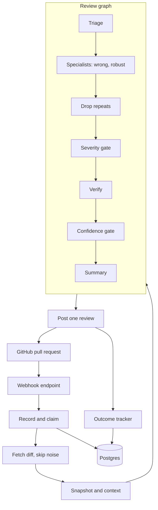
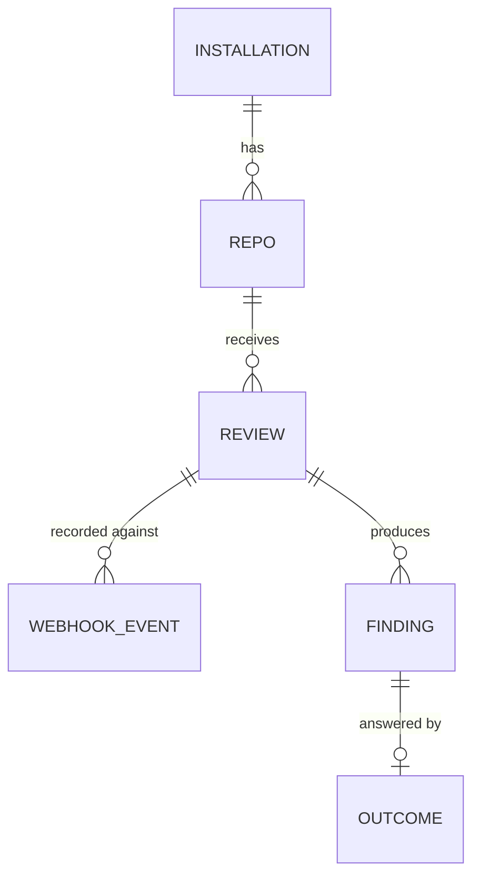
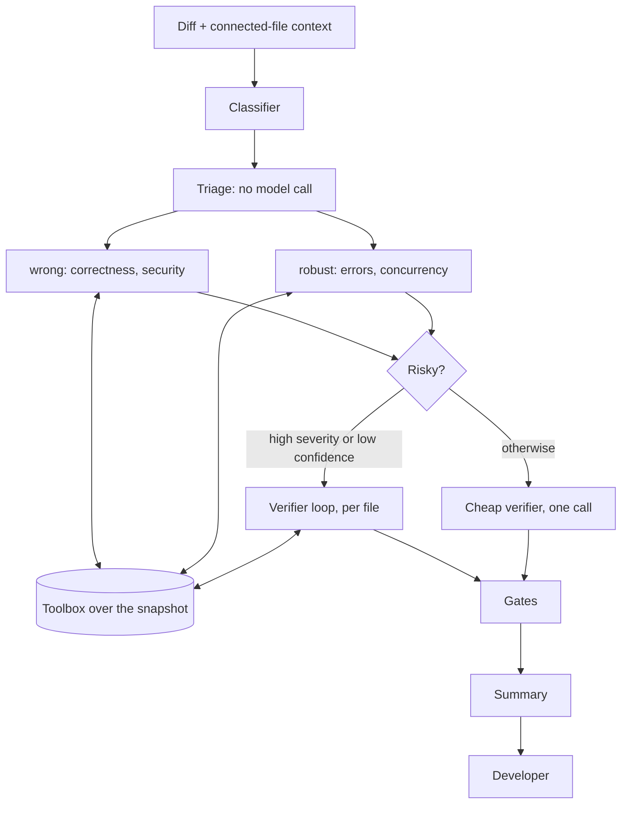

# PR Review Copilot — Complete Documentation

Generated from the 30 documents in `docs/` on 2026-11-14.
Edit those, then run `.venv/bin/python scripts/build_docs.py`.

## Contents

1. [PR Review Copilot — Project Overview](#pr-review-copilot-project-overview) — `01_Project_Overview.md`
2. [Business Requirements Document (BRD)](#business-requirements-document-brd) — `02_BRD.md`
3. [Product Requirements](#product-requirements) — `03_PRD.md`
4. [UX Requirements](#ux-requirements) — `04_UX_Requirements.md`
5. [Technical Requirements](#technical-requirements) — `05_TRD.md`
6. [High-Level Design](#high-level-design) — `06_HLD.md`
7. [Database Design](#database-design) — `07_Database_Design.md`
8. [API Specification](#api-specification) — `08_API_Specification.md`
9. [Low-Level Design](#low-level-design) — `09_LLD.md`
10. [Generative AI Architecture](#generative-ai-architecture) — `10_GenAI_Architecture.md`
11. [Security](#security) — `11_Security.md`
12. [Testing Strategy](#testing-strategy) — `12_Testing_Strategy.md`
13. [CI/CD](#cicd) — `13_CICD.md`
14. [Observability](#observability) — `14_Observability.md`
15. [Deployment](#deployment) — `15_Deployment.md`
16. [Quota & Resource Analysis](#quota-resource-analysis) — `16_Quota_Analysis.md`
17. [8-Week Project Roadmap](#8-week-project-roadmap) — `17_Roadmap.md`
18. [Team Responsibilities](#team-responsibilities) — `18_Team_Responsibilities.md`
19. [GitHub Repository Structure](#github-repository-structure) — `19_GitHub_Structure.md`
20. [PR Review Copilot](#pr-review-copilot) — `20_README.md`
21. [Architecture Decision Records](#architecture-decision-records) — `21_ADRs.md`
22. [Traceability Matrix](#traceability-matrix) — `22_Traceability.md`
23. [Interview Preparation](#interview-preparation) — `23_Interview_Questions.md`
24. [Viva / Project Defense](#viva-project-defense) — `24_Viva.md`
25. [Final Project Quality Score](#final-project-quality-score) — `25_Project_Score.md`
26. [End-to-End Walkthrough](#end-to-end-walkthrough) — `26_End_to_End_Walkthrough.md`
27. [Complete Flow — Viva Script](#complete-flow-viva-script) — `27_Viva_Flow.md`
28. [Feature Roadmap — Beyond the PRD](#feature-roadmap-beyond-the-prd) — `28_Feature_Roadmap.md`
29. [The Review Pipeline in Detail](#the-review-pipeline-in-detail) — `29_Agentic_Architecture.md`
30. [Design Notes](#design-notes) — `30_Design_Notes.md`

---

# PR Review Copilot — Project Overview

## Project Identity
- **Track:** Generative AI
- **Domain:** Developer Tools / Software Engineering
- **Duration:** 8 weeks
- **Team:** 1 student
- **Skill level:** Intermediate to Advanced
- **Primary users:** Engineering teams (2-15 developers), individual developers reviewing their own repos
- **Constraint:** No local GPU and no paid-API budget — orchestration-only, free-tier hosted LLM APIs

## Executive Summary
PR Review Copilot is an end-to-end AI code review system that reads a pull request's diff, gathers the surrounding code context it actually touches, generates targeted findings, verifies each finding against the real code before it's shown to anyone, and posts the result as real GitHub review comments.

The platform is intentionally designed as a **review-support system, not an autonomous merge gate**. A human developer remains responsible for the final decision to merge.

## Core Product Flow
PR opened or updated → webhook verified and the commit claimed → diff
fetched and parsed → repository snapshot downloaded → change classified →
triage picks which reviewers to wake → **one agent per changed file, per
reviewer, each able to grep and read the repository while it decides** →
a linter pass on the same changed lines → repeats dropped → severity gate
→ verification by a second model from a different family → confidence
gate → the repository's own settings and any suppressed categories →
severity-gated inline comments posted → outcome captured.

The single-pass version of this flow — classify, generate, judge, filter
— still exists and is what the pipeline falls back to. It was replaced as
the default because it could not find a defect whose two ends sat in
different files: the context it needed had to be chosen before anyone
knew what the bug was.

## MVP
1. GitHub App installable on a repo.
2. Webhook-triggered diff ingestion.
3. Lightweight connected-file context retrieval.
4. Task-decomposed review generation (targeted checks per change type).
5. Judge/grounding pass to discard ungrounded findings.
6. Confidence and duplicate filtering.
7. Severity-gated inline PR comments.
8. Outcome capture (accept/reject signal).
9. Evaluation harness (recall / false-positive rate on real historical PRs).

## Out of Scope for MVP
- Autofix, merging or blocking — out of scope by principle, not by effort.
- Multi-platform support (GitLab, Bitbucket, Azure DevOps).
- A configuration UI. Settings are a file in the repository instead.
- A dedicated SAST pillar. A curated linter pass runs, chosen rule by
  rule; a full security scanner is not in scope.
- IDE integration.
- Training or fine-tuning a model.
- Full-codebase graph indexing. Cross-file questions are answered by an
  agent at review time rather than by a pre-built index — the trade is
  flexibility against consistency, and the inconsistency is measurable.
- Chat on the pull request.

---

# Business Requirements Document (BRD)

## 1. Executive Summary
Small and mid-sized engineering teams merge code without dedicated senior review capacity, so bugs a careful review would catch ship to production instead. The proposed system reduces this gap by automatically reviewing every PR for cross-file-aware, verified findings, without the infrastructure weight of the heaviest competing tools.

## 2. Problem Statement
Reviewers are busy, review queues back up, and existing AI code-review tools split across unresolved trade-offs — diff-only tools miss cross-file breakage, full-context tools require heavy graph infrastructure, and general-purpose tools generate false-positive fatigue, the #1 stated developer complaint about the category.

## 3. Vision
Build a transparent, installable AI reviewer that understands what a change actually touches, double-checks its own findings, and gets more useful over time by learning what a specific team cares about.

## 4. Objectives
- Reduce the "no one had time to review this" gap for small teams.
- Catch cross-file-breaking changes that diff-only review misses.
- Keep false-positive rate low enough that developers don't dismiss the tool.
- Produce a measured, honest evaluation (recall / false-positive rate), not just "it runs."
- Keep the entire pipeline transparent and buildable by one engineer, unlike closed competitor products.

## 5. Personas
| Persona | Goals | Pain Points |
|---|---|---|
| Engineering team lead (2-15 devs) | Ship code without shipping avoidable bugs | No dedicated senior reviewer for every PR |
| Individual developer | Get a second opinion on their own PR | Busy teammates, slow review turnaround |
| Builder (student) | Demonstrate applied LLM-evaluation engineering | Needs a credible, measured result, not just a demo |

## 6. Business Use Cases
- Install the GitHub App on a repository.
- Open or update a pull request.
- Receive targeted, grounded review comments automatically.
- Resolve or dismiss a comment (feeding the outcome/feedback loop).
- Review the evaluation report (recall / false-positive rate).
- View per-repo suppression behavior (v2).

## 7. Business Requirements
| ID | Requirement | Priority | Acceptance Criteria |
|---|---|---|---|
| BR-001 | App can be installed on a GitHub repository | Must | Installation completes via GitHub App flow |
| BR-002 | System detects PR open/update events | Must | Webhook received and signature verified |
| BR-003 | System fetches and parses the diff | Must | Structured hunks available per changed file |
| BR-004 | System gathers connected-file context | Must | Files referencing changed functions/classes are retrieved |
| BR-005 | System generates targeted findings per change type | Must | Findings include file, line, severity, category, rationale, confidence |
| BR-006 | System verifies findings before posting | Must | Ungrounded findings are discarded by the judge pass |
| BR-007 | System filters low-confidence/duplicate findings | Must | Only confident, deduplicated findings remain |
| BR-008 | System posts comments directly on the PR | Must | Comments appear inline on GitHub, severity-gated |
| BR-009 | System records comment outcomes | Must | Accept/reject signal stored per finding |
| BR-010 | System reports evaluation results | Should | Recall and false-positive rate available from a documented run |

## 8. Non-Functional Requirements
- Security: minimum-necessary GitHub App permissions; verified webhook signatures.
- Performance: a typical PR (≤8 files) should receive comments within roughly a minute.
- Reliability: transient LLM/API failures should not silently drop a review.
- Auditability: every posted finding retains its model, prompt-template, and confidence metadata.
- Cost: zero paid API spend — free-tier providers only; track API requests per review from week 1, since request quota is the binding constraint.

## 9. Success Metrics

| Metric | Where it stands |
|---|---|
| Recall against labelled defects | **56%** on the flagpole case |
| Precision | **82%** measured; zero comments on five deliberately clean sections across 47 posted |
| Cost per review | ~110 model calls, ~40 seconds, recorded per review row |
| Judge accuracy | contradicted a false positive in three consecutive runs, after eighteen of agreeing with everything |
| Qualitative | installed on the builder's own repositories; every defect posted so far has been real |

The number worth defending is precision. Independent reporting on this
market found that no party without a commercial stake has published a
false-positive rate for any shipping AI code reviewer; vendor figures
disagree with each other by wide margins. A measured precision on a set
with deliberate false-positive bait is the thing this project has that
the category does not.

## 10. Risks
| Risk | Probability | Impact | Mitigation |
|---|---|---|---|
| False-positive fatigue | Medium | High | Judge pass + confidence filtering built into v1, not deferred |
| Hard to source real-world test data | Medium | Medium | Use open-source repos with documented bugfix-commit history instead of private team data |
| Free-tier request quota exhausted during eval tuning | Medium | Medium | Batch classifier and judge calls to cut ~20 API calls per review down to ~7; spread stages across multiple providers; track requests per review from week 1 |
| Hosting cold-starts delay first review after inactivity | Medium | Low | Accepted tradeoff on free-tier hosting; documented, not hidden |
| Scope creep toward autofix/multi-platform/security scanning | Medium | Medium | Explicitly deferred to Version 3 with reasons documented |

## 11. MVP Scope
**In scope:** GitHub App install, webhook ingestion, connected-file context, task-decomposed review, judge/grounding pass, confidence/dedup filtering, severity-gated comment posting, outcome capture, evaluation harness.

**Out of scope:** autofix, multi-platform support, custom rules UI, dedicated security scanning, IDE integration, model training.

## 12. Future Scope
- PR-level summary comment.
- Feedback-driven per-repo suppression.
- Deeper cross-file dependency graph.
- Confidence scores surfaced in comments.
- Multi-platform support.
- Autofix suggestions.

---

# Product Requirements

## Goal

An installable GitHub App that reads a pull request the way a careful senior
engineer would, checks its own findings against the code, and posts the ones
worth a developer's attention as inline comments.

## Principles

- **Grounded before posted.** Every finding is checked against real code by a
  second model before anyone sees it.
- **Human in the loop.** It comments. It never blocks a merge or merges
  anything.
- **Quiet by default.** Severity-gated. A reviewer that posts everything is
  one nobody reads.
- **Measured, not claimed.** Quality statements come from the evaluation
  harness, and name the model that produced them.
- **Honest about what it did not do.** A review that could not read the
  repository says so rather than quietly reviewing less.

## Features

| Feature | Priority | Status |
|---|---|---|
| GitHub App installation | Must | built |
| Webhook-triggered diff ingestion | Must | built |
| Connected-file context | Must | built |
| Targeted review generation | Must | built |
| Verification before posting | Must | built |
| Severity and confidence gates | Must | built |
| Repeat suppression across commits | Must | built |
| Severity-gated inline comments | Must | built |
| Pull-request summary comment | Must | built |
| Outcome capture | Must | built |
| Evaluation harness | Must | built |
| Suggested replacement lines | Should | built |
| Multi-language review | Should | built, not evaluated |
| Linter pass before the model | Should | built |
| Feedback-driven suppression | Should | built |
| Per-repository configuration | Should | built |
| Deployment | Must | **not built** |
| Deeper cross-file graph | Could | not built |
| Autonomous fixing or merging | Won't | out of scope by principle |

Suggested replacement lines were originally out of scope. They are in because
a one-line fix behind GitHub's Apply button is cheap to offer and easy to
refuse: the suggestion is applied to the real file and must compile, and a
refused suggestion never hides the comment carrying it.

## User stories

### US-001 — Install it
As a team lead, I install the reviewer on a repository so every future pull
request is reviewed automatically.

- Installation completes through GitHub's App flow.
- It requests pull requests read/write and contents read, nothing else.

**Built.**

### US-002 — See past the diff
As a developer, I want findings about code my change breaks, not only lines I
touched.

- A finding may reference a file the pull request did not change.
- The comment sits on the changed line that caused the break and names the
  other end.

**Built.** The reviewer reads the repository at the commit under review and
can grep, open files and follow references while deciding.

### US-003 — Not be shown false alarms
As a developer, I want the reviewer to check itself before commenting.

- A finding the verifier contradicts never reaches the pull request.
- A finding it cannot check is kept at reduced confidence, not deleted and
  not trusted.

**Built.**

### US-004 — Only important issues
As a developer, I want the pull request to stay readable.

- Low severity and low confidence are stored but not posted.
- The summary says how many were held back, so nothing is hidden silently.

**Built.** A repository sets its own thresholds in `.pr-review.yml`:
which severities reach the pull request, the confidence floor, categories
to leave alone, and how many comments at most. Adding `low` to
`severities` is how a team asks to see everything. The file lives in the
repository under review, so the people being commented on own the
settings and a branch can change them.

### US-005 — A credible number
As a builder, I want a measured recall and false-positive rate I can defend.

**Partly built.** The harness, the scoring and the ablations exist. Four
labelled cases is too few to separate a real improvement from noise, and all
four are Python.

### US-006 — Stop repeating what we dismiss
As a team, I want the reviewer to fall silent on a category we keep
dismissing.

**Built, and deliberately slow to act.** A category is silenced for a
repository once at least ten findings in it have been posted and fewer
than one in five were acted on.

The evidence needs care. GitHub never says "this comment was wrong" — only
that a thread was resolved — so a rejection cannot be stored, and an
acceptance rate over stored rows alone would always read 100%. The
denominator is therefore every finding posted in that category and the
numerator is the ones somebody resolved. A suppressed finding is held, not
deleted, so lowering the threshold recovers it without re-reviewing.

It will still say nothing until a repository has real history, which is
correct rather than a limitation.

## What a review produces

One GitHub review containing:

- an opening comment: what changed, what is worth a look, how many comments
  follow and how many were held back
- one inline comment per finding, at a changed line, carrying severity,
  category, the problem, the reasoning and the files that were read
- a suggested replacement line where one is safe

## States

```
installed ──> delivery received ──> claimed ──> reviewing ──> posted
                     │                 │            │
                     ├──> ignored      └──> superseded
                     └──> duplicate                 ├──> skipped
                                                    ├──> nothing to say
                                                    ├──> all said before
                                                    └──> failed
```

`all said before` is deliberately distinct from `nothing to say`: a review
that found the same three problems again is not a review that found nothing.

## Out of scope

- Merging, blocking a merge, or approving.
- Executing any code from a pull request.
- Reviewing anything but the diff and the repository at that commit.
- Replacing a human reviewer. It is a second pair of eyes that never gets
  tired, not a senior engineer.

---

# UX Requirements

## Primary Interface
The primary interface is **GitHub itself** — there is no separate frontend in v1. The product's UX is the quality and placement of PR comments.

## Information Architecture
1. GitHub PR page (primary surface — inline review comments)
2. GitHub App installation/settings page (GitHub-hosted)
3. *(Optional, v2+)* Lightweight web dashboard — installed repos, recent reviews, quota report, eval results

## Primary User Flow
Install app on repo → open/update PR → wait about 40 seconds → review
appears as inline comments, severity-gated, with a one-line fix behind
GitHub's Apply button where the whole fix fits on the line → resolve or
dismiss each comment → the reviewer notices which categories a repository
stops acting on and goes quiet on them.

A repository that wants different thresholds adds `.pr-review.yml`. There
is no dashboard and no settings UI; the settings live in the repository
so the people being commented on own them.

## Key Surface Requirements

### PR Comment Thread (primary surface)
- Each finding: file, line, severity badge, category, plain-language rationale.
- High/medium severity posted by default; low severity suppressed.
- No more than a handful of comments per PR — dedup and filtering keep it readable.

### Optional Dashboard (v2+)
- List of installed repos.
- Recent reviews with severity breakdown.
- Requests-per-review and cumulative quota consumption.
- Eval report (recall / false-positive rate) from the latest harness run.

## States
Every asynchronous step (webhook received, processing, posted, failed) should be distinguishable in logs/dashboard even where there's no UI screen for it.

## Accessibility
- Comment text avoids color-only severity signaling (badge text, not just color).
- If a dashboard is built, it follows standard semantic HTML and keyboard-navigable controls.

---

# Technical Requirements

## Stack

| | Choice | Notes |
|---|---|---|
| Backend | Python 3.14, FastAPI | async, webhook-shaped |
| GitHub | GitHub App — webhooks and REST, scoped permissions | ADR-001 |
| Model provider | Groq, OpenAI-compatible, behind our own client | ADR-003 |
| Generation | `openai/gpt-oss-120b` | classification, specialists, summary |
| Verification | `qwen/qwen3.8-27b` | a different family, deliberately |
| Orchestration | LangGraph, for flow between stages only | ADR-011 |
| Diff parsing | `unidiff` | |
| Code understanding | `tree-sitter` — Python, JavaScript, TypeScript, TSX | |
| Database | PostgreSQL (Neon) | |
| Migrations | Alembic | |
| Hosting | **not deployed** | runs on a laptop |

Swapping provider is four environment variables: `LLM_API_KEY`,
`LLM_BASE_URL`, `LLM_MODEL`, `LLM_JUDGE_MODEL`.

## Why these

**FastAPI.** The service is a webhook endpoint that must answer inside ten
seconds while the real work continues behind it. Async and background tasks
are the whole requirement.

**A GitHub App, not a token.** An App has its own identity and
per-installation scoping, which is what a thing other people install needs.
A personal token is tied to an account and cannot be distributed.

**Free-tier models behind our own client.** There is no budget for paid
inference, so every stage runs on a free tier. The client is ours rather than
a library's because the binding constraint is tokens per minute: it has to
reserve budget *before* sending and distinguish a minute's limit from a
day's. Libraries that retry after a refusal make that worse.

**PostgreSQL, not a document store.** Reviews, findings and outcomes are
related by foreign keys, and the idempotency guarantees are unique
constraints. Both are things a relational database does and a document store
imitates.

**LangGraph for flow, our code inside it.** Two reviewers run concurrently
and a verifier loops, so the sequence branches and is worth resuming
part-way. LangGraph owns the edges between stages; every HTTP call to a model
stays ours. Full reasoning in ADR-011, which supersedes the earlier decision
to use no framework at all.

## Requirements

| ID | Requirement | Status |
|---|---|---|
| TR-001 | Webhook endpoint with signature verification | built |
| TR-002 | Diff fetch and structured parsing | built |
| TR-003 | Connected-file context from a repository snapshot | built |
| TR-004 | Change classifier, batched to fit the token window | built |
| TR-005 | Structured, validated output for every model reply | built |
| TR-006 | Verification by a second model, with abstention | built |
| TR-007 | Severity and confidence gates; repeats dropped | built |
| TR-008 | One batched review, comments by line and side | built |
| TR-009 | Outcome-tracking schema and thread events | built |
| TR-010 | Evaluation harness with ablations | built |
| TR-011 | Tool loop with bounded turns, calls and tokens | built |
| TR-012 | Per-model token budgets, reserved before sending | built |
| TR-013 | Resume a review interrupted by a restart | built |
| TR-014 | Retire a review when a newer commit arrives | built |
| TR-015 | Multi-language parsing: Python, JS, TS, TSX | built, evaluated |
| TR-016 | Deployment GitHub can reach | **not built** |
| TR-017 | Per-repository suppression from outcomes | built |
| TR-018 | Per-repository configuration file | built |
| TR-019 | Linter pass on changed lines, before the model | built |
| TR-020 | Model, prompt version and cost recorded per finding | built |

## Non-functional targets

| | Target | Measured |
|---|---|---|
| Review latency | under 60s | **428s** on the free tier, nearly all of it waiting for token budget |
| Tokens per review | — | ~65,000 on a four-file pull request |
| Secrets | never in source | `.env`, gitignored; key file path, not the key |
| Source code in logs | only what a specific failure needs | holds |

The latency target is not met and will not be on a free tier: 8,000 tokens a
minute against a review that wants 65,000 is nine minutes of waiting before
any thinking. It is a tier limit, not a code limit — the same review on a
paid tier fits inside one minute's budget. Stated rather than quietly
dropped.

**Provenance.** Every finding records the model that produced it, a
`prompt_version` derived from the prompt text itself, and which specialist
or the linter found it. Every review records its model calls, prompt and
completion tokens, and seconds. The prompt version is a hash rather than a
hand-maintained number, because a version nobody remembers to bump is worse
than none: it claims a finding came from a prompt that may not be the one
that produced it.

**Measured.** On the flagpole case — 246 lines, 8 files, Python and TSX, 16
labelled defects and five deliberate false-positive baits — the harness
reports **56% recall, 82% precision, 67% F1** through the agentic pipeline.
Reproduce it with:

```bash
AGENTIC_PIPELINE=1 .venv/bin/python -m src.evaluation.run \
    --case flagpole-scheduled-rollouts --only H0
```

Earlier numbers quoted in this project came from reading logs. This one does
not.

---

# High-Level Design

The service reviews a pull request and posts inline comments on it. It runs
as one FastAPI process, stores everything in Postgres, and reaches a model
through an OpenAI-compatible API.

## Architecture



## Components

| Component | Responsibility | Lives in |
|---|---|---|
| Webhook endpoint | Signature check, idempotency, claiming a commit | `src/webhooks/` |
| Pipeline | Records, runs the review, posts, records what posted | `src/pipeline/` |
| Review graph | The stages above, as a checkpointed LangGraph state graph | `src/pipeline/graph.py` |
| Diff ingestion | Changed files, skip rules, hunks and line numbers | `src/diff/` |
| Connected-file context | Snapshot, changed symbols, verified references, ranked bundle | `src/context/` |
| Classifier | Labels each file; path rules first, one batched model call for the rest | `src/classification/` |
| Agents | The tool loop, the toolbox, the specialist prompts, triage, summary | `src/agents/` |
| Judge | Verifies findings — one cheap call, or a tool loop for risky ones | `src/judge/` |
| Gates | Holds back low severity and low confidence; drops repeats | `src/filter/` |
| GitHub client | App JWT, installation tokens, pagination, posting | `src/github/` |
| Model client | HTTP, per-model token budgets, retries, tool-call parsing | `src/llm/` |
| Outcome tracker | Records resolved and reopened comment threads | `src/outcomes/` |
| Recovery | Picks up reviews interrupted by a restart | `src/recovery.py` |
| Evaluation harness | Replays labelled pull requests, scores, runs ablations | `src/evaluation/` |
| Deployment | Somewhere GitHub can reach without a laptop | **not built** |

## How one review runs

1. A developer opens or updates a pull request.
2. GitHub sends a `pull_request` webhook.
3. The endpoint verifies the signature, records the delivery, claims the
   commit, and replies. All of this happens before any slow work: GitHub
   allows ten seconds and never retries.
4. Claiming retires any unfinished review of an older commit on the same
   pull request, so a second push does not leave two reviews competing.
5. The pipeline fetches the changed files and skips lockfiles, vendored code
   and generated output.
6. The repository is downloaded at the reviewed commit. Changed symbols are
   resolved and verified references to them found elsewhere, each with a
   confidence score.
7. The classifier labels each file. Path rules settle tests, migrations,
   dependency files, docs and config with no model request.
8. Triage reads those labels and decides which specialists to wake. It makes
   no model call of its own.
9. Two specialists run concurrently, each a tool loop over the snapshot:
   **wrong** looks for correctness and security, **robust** for error
   handling and concurrency. Both start from the context of step 6 and may
   read files, grep, look up definitions, find references and list tests.
10. Findings already posted on an earlier commit are dropped before anything
    is spent verifying them.
11. The severity gate drops what could never be posted.
12. Verification: a high-severity or low-confidence finding gets its own tool
    loop, one per file. Everything else gets a single cheap call to a model
    from a different family.
13. The confidence gate decides what posts.
14. A summary is written, but only when something will post.
15. One batched review is submitted, then the comment ids GitHub omits from
    the create response are fetched.
16. The outcome tracker records thread resolution against those ids.

The pipeline takes a pull request and a review id, never an HTTP request.
That is what lets the evaluation harness replay historical pull requests with
no webhook involved.

`AGENTIC_PIPELINE=0` runs a single-pass alternative instead of steps 8–14:
one generation call and one judge call. Both produce the same `ReviewOutcome`
and can be pointed at the same evaluation cases, which is how the cost of the
agents is measured rather than assumed.

## Models

| Role | Model |
|---|---|
| Classification, specialists, summary | `openai/gpt-oss-120b` |
| Judge and verifier | `qwen/qwen3.8-27b` |

The verifier is deliberately a different family from the generator, because a
model asked to check its own work mostly agrees with itself.

## Known limitations

- **Connected-file context finds callers of changed functions, not consumers
  of changed data shapes.** A renamed dictionary key breaks files that
  reference a string literal, not a function name. The specialists' `grep`
  tool is what covers this case; the pre-built context does not.
- **A delivery that arrives while the service is down is lost.** GitHub does
  not retry.
- **Development and production share one database.** Separate test database,
  but a bad migration locally reaches real rows.
- **Not deployed.** The service only runs on a laptop.

## Scalability

One FastAPI process is enough at this scale. Review work runs as a background
task so the webhook reply is never blocked on model latency. If volume grew,
the next step is a queue between receipt and processing.

The binding constraint is not CPU but the model's tokens-per-minute budget,
which is why `src/llm/budget.py` reserves tokens per model before sending
rather than discovering the limit by being refused.

## Reliability

- Timeouts on every model and GitHub call; transient failures retried.
- A spent daily token budget fails immediately rather than retrying into
  silence.
- No database session is held across a review, which can take minutes.
- A review interrupted by a restart is found and resumed at the next start.
- Binary files, lockfiles and empty diffs are skipped, not crashed on.

## Security

- GitHub App permissions: pull requests read/write, contents read.
- Every webhook signature verified against the raw bytes.
- No code from a pull request is ever executed; analysis is static.

---

# Database Design

Six tables in Postgres. Every column below exists in `src/db/models.py`;
migrations are in `alembic/versions/`.

## Tables

### installations

Someone who installed the App on their account.

| Column | Type | Notes |
|---|---|---|
| `id` | integer | primary key |
| `github_installation_id` | bigint | **unique** — GitHub's id, what tokens are issued against |
| `account_login` | varchar(255) | |
| `installed_at` | timestamptz | |

### repos

| Column | Type | Notes |
|---|---|---|
| `id` | integer | primary key |
| `installation_id` | integer | → `installations.id` |
| `github_repo_id` | bigint | **unique** — matched on this, never the name |
| `full_name` | varchar(512) | `owner/repo`, refreshed on every event |
| `default_branch` | varchar(255) | |
| `created_at` | timestamptz | |

A repository can be renamed at any time; its id cannot change. Everything
keys on `github_repo_id`, and `full_name` is treated as a label.

### webhook_events

One row per authenticated delivery — including duplicates and ignored
actions — so every delivery is accounted for. A request that fails signature
verification is logged and never stored, so unauthenticated input does not
reach the database. The payload is not kept, only the fields that identify
the event.

| Column | Type | Notes |
|---|---|---|
| `id` | integer | primary key |
| `delivery_id` | varchar(64) | **unique** — the `X-GitHub-Delivery` GUID |
| `event` | varchar(64) | `pull_request`, `pull_request_review_thread` |
| `action` | varchar(64) | `opened`, `synchronize`, … |
| `github_repo_id` | bigint | nullable |
| `pr_number` | integer | nullable |
| `head_sha` | varchar(40) | nullable |
| `outcome` | varchar(16) | `accepted` / `duplicate` / `ignored`, checked |
| `review_id` | integer | nullable → `reviews.id` |
| `received_at` | timestamptz | |

### reviews

One row per unit of work: one commit on one pull request.

| Column | Type | Notes |
|---|---|---|
| `id` | integer | primary key |
| `repo_id` | integer | → `repos.id` |
| `pr_number` | integer | |
| `head_sha` | varchar(40) | the commit under review |
| `status` | varchar(32) | checked against the nine valid statuses |
| `attempts` | integer | runs started; caps automatic recovery |
| `error_code` | varchar(64) | nullable, set when `status = failed` |
| `context_status` | varchar(16) | nullable — `ok` / `degraded` / `unavailable` |
| `github_review_id` | bigint | nullable, set once GitHub accepts |
| `model_calls` | integer | nullable — what the review cost |
| `prompt_tokens` | integer | nullable |
| `completion_tokens` | integer | nullable |
| `seconds` | float | nullable |
| `created_at` | timestamptz | |
| `updated_at` | timestamptz | refreshed on every change; finds stuck reviews |

**`UNIQUE (repo_id, pr_number, head_sha)`** is the idempotency key. Claiming
is an insert against it, so two messages about one commit produce one review
and the loser is told nothing came back.

`context_status` records how good the connected-file context was, so a weak
review can be explained rather than guessed at afterwards.

### findings

Every finding is stored, including those the gates hold back, so thresholds
can be retuned without re-running the reviewer (ADR-010).

| Column | Type | Notes |
|---|---|---|
| `id` | integer | primary key |
| `review_id` | integer | → `reviews.id` |
| `file` | varchar(1024) | |
| `line` | integer | |
| `severity` | varchar(32) | |
| `category` | varchar(64) | |
| `message` | text | nullable — the sentence the developer actually read |
| `rationale` | text | |
| `confidence` | float | |
| `model` | varchar(128) | nullable — which model produced it |
| `prompt_version` | varchar(32) | nullable — a hash of the prompt text |
| `found_by` | varchar(32) | nullable — `wrong`, `robust` or `lint` |
| `posted` | boolean | |
| `github_comment_id` | bigint | nullable — how an outcome is matched back |

### outcomes

What the developer did with a comment. This is how the project measures
whether it is useful rather than merely finished.

| Column | Type | Notes |
|---|---|---|
| `id` | integer | primary key |
| `finding_id` | integer | → `findings.id` |
| `repo_id` | integer | → `repos.id` |
| `category` | varchar(64) | copied from the finding, so it can be grouped |
| `outcome` | varchar(16) | `accepted` / `rejected` / `ignored` |
| `recorded_at` | timestamptz | |

**`UNIQUE (finding_id)`** — one current outcome per finding. A thread can be
resolved and reopened, so the row is replaced rather than appended to.

## Relationships



## Indexes and constraints

| | Purpose |
|---|---|
| `installations.github_installation_id` unique | one row per installation |
| `repos.github_repo_id` unique | one row per repository |
| `webhook_events.delivery_id` unique | the same message twice |
| `uq_reviews_repo_pr_head` | two messages about the same commit |
| `uq_outcomes_finding` | one current outcome per finding |
| `ix_repos_installation_id` | repositories for an installation |
| `ix_reviews_repo_created` | a repository's review history |
| `ix_reviews_status_updated` | the stuck-review recovery scan |
| `ix_findings_review_id` | a review's findings |
| `ix_outcomes_repo_category` | acceptance rate per category, per repository |
| `ix_findings_model_prompt` | what each model and prompt version actually found |
| `ck_reviews_status` | rejects a status nothing understands |
| `ck_reviews_context_status` | same, for context quality |
| `ck_webhook_events_outcome` | same, for delivery outcome |

The check constraints exist so a typo is refused by the database rather than
stored and discovered later by something that cannot interpret it.

## Lifecycle

```
delivery recorded ──> commit claimed ──> review runs ──> findings stored
                            │                                  │
                      (or duplicate,                      gates decide
                       ignored, superseded)                     │
                                                          review posted
                                                                │
                                                       comment ids matched
                                                                │
                                                        outcome recorded
```

Findings are stored **before** posting, so a posting failure loses nothing.
`github_review_id` and `github_comment_id` are set only after GitHub accepts,
which is what lets an outcome be tied back to the finding that produced it.

## Known gaps

- **Development and production share one database.** The test database is
  separate and wiped on every run, which is why `conftest.py` refuses to
  start when `TEST_DATABASE_URL` matches `DATABASE_URL`.
- **Reviews 1–23 predate the provenance columns** and carry nulls there.
  Backfilling them with a guess would be worse than leaving them blank,
  which at least says "we did not record this".
- **A rejection is never stored.** GitHub reports a thread resolved or
  unresolved, and nothing else, so `outcomes` only ever holds `accepted`.
  Suppression works around it by taking the denominator from posted
  findings rather than from stored outcomes — see the product
  requirements, US-006.

---

# API Specification

This service has **two routes**. The integration surface is GitHub's webhook,
not a REST API, so most of what matters here is the contract with GitHub in
both directions: what we accept, and what we call.

## What we serve

### POST /webhooks/github

Every GitHub delivery arrives here. Handled in order:

1. **Signature.** `X-Hub-Signature-256` is checked against the raw bytes with
   `hmac.compare_digest`. A failure is logged and nothing is stored, so
   unauthenticated input never reaches the database.
2. **Headers.** `X-GitHub-Event` and `X-GitHub-Delivery` must both be present.
3. **Body.** Must parse as JSON, and a pull-request event must carry the
   fields the pipeline needs.
4. **Route.** A review-thread event records an outcome. A pull-request event
   claims a review. Anything else is recorded and ignored.
5. **Reply, then work.** The review is claimed inside the request and the
   actual review runs as a background task, because GitHub allows ten seconds
   and never retries a timeout.

**Events subscribed to**

| Event | Actions acted on |
|---|---|
| `pull_request` | `opened`, `synchronize`, `reopened`, `ready_for_review` |
| `pull_request_review_thread` | `resolved`, `unresolved` |

`synchronize` is a push to the branch. The thread events are the only way the
project learns whether a comment was useful.

**Success responses — all `200`**

Every authenticated delivery gets a `200`, including duplicates and ignored
actions. GitHub treats any non-2XX as a failed delivery, so a `409` for a
correctly handled duplicate would report working behaviour as broken.

The body names what happened:

| Body | Meaning |
|---|---|
| `{"status": "accepted", "review_id", "repository", "pull_request", "head_sha"}` | claimed; the review is now running |
| `{"status": "accepted", "recorded": n, "resolved": bool}` | a thread event matched `n` of our comments |
| `{"status": "duplicate", "delivery": "..."}` | this delivery id was already stored |
| `{"status": "duplicate", "reason": "commit already claimed"}` | another delivery holds this commit |
| `{"status": "ignored", "event", "action"}` | authenticated, recorded, not something to review |
| `{"status": "ignored", ..., "reason": "not our comments"}` | a thread on comments we did not post |

Two different duplicates, deliberately distinguished: the same *message* twice,
and two different messages about the same *commit*. The first is GitHub
retrying; the second is a reopen with no new code.

**Error responses**

```json
{
  "error": {
    "code": "WEBHOOK_SIGNATURE_INVALID",
    "message": "The request could not be verified.",
    "requestId": "req_123"
  }
}
```

| Status | Code | Cause |
|---|---|---|
| `401` | `WEBHOOK_SIGNATURE_INVALID` | signature missing or wrong |
| `400` | `WEBHOOK_HEADERS_MISSING` | no event or delivery header |
| `400` | `WEBHOOK_PAYLOAD_MALFORMED` | body is not JSON |
| `400` | `WEBHOOK_PAYLOAD_INCOMPLETE` | a field the pipeline needs is absent |

The `401` message is vague on purpose: a forger should learn nothing from the
reply.

### GET /health

Returns `{"status": "ok"}`. No database or provider check — it answers whether
the process is up, nothing more.

## Error codes recorded, not returned

A review fails after the `200` has been sent, so these never reach a caller.
They are stored on `reviews.error_code` and are how a failure is diagnosed
afterwards:

| Code | Cause |
|---|---|
| `LLM_NOT_CONFIGURED` | no API key, or the provider is unreachable |
| `COMMENT_POST_FAILED` | findings stored, GitHub refused the review |
| `PIPELINE_UNEXPECTED` | anything else, with the traceback logged |

## What we call

GitHub's REST API, through one client that handles authentication, pagination
and retries.

| Method | Endpoint | Used for |
|---|---|---|
| `POST` | `/app/installations/{id}/access_tokens` | exchange a signed JWT for an installation token |
| `GET` | `/repos/{owner}/{repo}/pulls/{n}/files` | the diff, paginated |
| `GET` | `/repos/{owner}/{repo}/tarball/{sha}` | the repository at the commit under review |
| `GET` | `/repos/{owner}/{repo}/contents/{path}` | a single file, when the tarball is unavailable |
| `POST` | `/repos/{owner}/{repo}/pulls/{n}/reviews` | one batched review: summary plus inline comments |
| `GET` | `/repos/{owner}/{repo}/pulls/{n}/comments` | the comment ids GitHub assigned |

Two of these carry a decision worth stating.

**The tarball, not the contents endpoint.** The agent greps and opens files
while it works, and per-file HTTP would be both slow and a quota problem. The
archive is downloaded once per review, capped at 50 MB with a 1 MB per-file
limit, and extracted to a temporary directory.

**`/pulls/{n}/comments`, not `/reviews/{id}/comments`.** The review-scoped
endpoint answers in the old positional format with `line` always null. The
pull-request-scoped one reports `line` and `side` and names the review each
comment belongs to, which is what lets an outcome be matched back to the
finding that produced it.

The review is posted as a single `COMMENT` event with at most 25 inline
comments. One request rather than one per finding, and `COMMENT` rather than
`REQUEST_CHANGES` because the reviewer never blocks a merge.

## Not built

The original specification listed `GET /repos`, `/repos/:id/reviews`,
`/reviews/:id`, `/reviews/:id/findings`, `/eval-report` and `/quota-report`
under a `/api/v1` prefix. None exist, and no prefix is in use.

They were planned for a dashboard that was never started. `/quota-report` is
the one with a real gap behind it: it cannot be written today, because token
and call counts live in an in-memory counter and are never stored. See the
quota analysis.

The findings and evaluation data are read with SQL and the harness's JSON
report instead. That is adequate for one developer and not adequate for anyone
else, which is the honest reason these are absent rather than a decision that
they were unnecessary.

---

# Low-Level Design

How the service is built, package by package. The shape is in
[06_HLD.md](06_HLD.md); the review stages are in
[29_Agentic_Architecture.md](29_Agentic_Architecture.md). This is the layer
below both: what lives where, what may import what, and the rules that keep
one failure from becoming two.

## 1. Module map

```text
src/
  main.py            FastAPI application, startup, /health
  config.py          settings, read once and validated at startup
  recovery.py        picks up reviews interrupted by a restart

  webhooks/          receiving events from GitHub
    signature.py       HMAC-SHA256 verification
    events.py          which events matter, and the fields kept
    router.py          POST /webhooks/github

  pipeline/          running one review
    record.py          database and GitHub side; posts the result
    graph.py           the stages, as a LangGraph state graph
    agentic.py         opens resources, invokes the graph
    single_pass.py     the one-call alternative
    prepare.py         fetch and filter, shared by both

  agents/            the tool loop and what runs inside it
    loop.py            send, run tools, send again, stop
    tools.py           read_file, grep, definitions, references, tests
    prompts.py         the two specialist prompts
    specialists.py     runs them concurrently, reads their findings
    triage.py          which specialists to wake; no model call
    summary.py         the opening comment
    answers.py         pulling JSON out of a reply
    measure.py         turn and token measurement harness

  llm/               talking to a model
    provider.py        the HTTP client
    budget.py          per-model token budgets, reserved before sending
    errors.py          what can go wrong, by what the caller does about it
    messages.py        tool calls and completions, on the wire
    settings.py        where to send, how hard to try

  github/            talking to GitHub
    auth.py            App JWT, then installation token
    client.py          requests, pagination, headers
    review.py          building and posting one review

  diff/              working out what changed
    files.py           fetch the changed file list
    skip.py            which files are worth reviewing
    parse.py           patch text into hunks and line numbers

  context/           connected-file context
    snapshot.py        the repository at the reviewed commit
    symbols.py         what changed, as definitions
    references.py      who uses them, with confidence
    languages.py       tree-sitter queries per language
    bundle.py          ranked, budgeted context
    gather.py          the entry point

  classification/    labelling each changed file
  judge/             verifying findings, cheaply or by looking
  filter/            gates, repeats, suggestions
  review/            findings, prompts, generation for the single pass
  outcomes/          recording what the developer did
  db/                models, queries, session, url
  evaluation/        replaying labelled pull requests
  common/            trace.py, the structured terminal trace
```

Six tables: `installations`, `repos`, `reviews`, `webhook_events`,
`findings`, `outcomes`.

### Dependency rules

Enforced by convention. A violation is a design smell, not a build failure.

| Layer | May import | May not import |
|---|---|---|
| `config` | nothing from `src` | anything |
| `webhooks/signature` | nothing from `src` | anything, including FastAPI |
| `webhooks/events` | nothing from `src` | anything |
| `llm/*` | `config` | everything else |
| `db/*` | `config`, `webhooks.events` | `github`, `diff`, `pipeline` |
| `github/*` | `config` | `db`, `diff`, `pipeline` |
| `diff/*` | `github.client` | `db`, `pipeline` |
| `context/*`, `agents/*` | `llm`, `diff`, `github.client` | `db`, `pipeline` |
| `pipeline/*` | everything below | `webhooks.router` |
| `webhooks/router` | `config`, `db`, `pipeline` | `diff`, `github` directly |

Three rules carry weight:

- **`signature.py` imports no framework**, so it is testable without a web
  server.
- **`pipeline/` never imports the router**, so the evaluation harness drives
  a review with no HTTP involved.
- **Nothing outside `llm/` makes an HTTP call to a model.** Every request
  passes one place, which is where retries, token budgets and tool-call
  parsing live.

## 2. Configuration

`src/config.py` reads `.env` once, validates the required variables at
startup, and hands out a frozen `Settings`. Discovering a missing secret when
the first pull request arrives is far worse than refusing to start.

Required: `GITHUB_WEBHOOK_SECRET`, `GITHUB_APP_ID`, `GITHUB_CLIENT_ID`,
`GITHUB_APP_PRIVATE_KEY_PATH`, `DATABASE_URL`.

The model is not among them. `LLM_API_KEY` is read where it is used, so a
service without one still starts and skips reviews with a clear status rather
than failing to boot.

Switches, all read with `os.getenv` at the point of use:
`AGENTIC_PIPELINE`, `CONTEXT_ENABLED`, `JUDGE_ENABLED`, `SUGGESTIONS_ENABLED`,
`TEMPLATES_ENABLED`, `RECOVERY_ON_STARTUP`, `PIPELINE_TRACE`.

## 3. Idempotency

Two independent keys, catching different problems:

| Key | Catches | Typical cause |
|---|---|---|
| `webhook_events.delivery_id` | the same message twice | the Redeliver button |
| `reviews(repo_id, pr_number, head_sha)` | two messages about the same code | reopening a pull request with no new commits |

Both answer `200 duplicate`. When the second fires, the delivery row's
`outcome` is corrected from `accepted` to `duplicate`, so the record stays
honest.

Claiming is an `INSERT ... ON CONFLICT DO NOTHING ... RETURNING id`. Whoever
writes the row owns the work; the loser gets nothing back. Checking first in
Python would race when two messages arrive together.

Review ids skip numbers, because a rejected insert still consumes a sequence
value. Expected, not a lost row.

## 4. Review state machine

```
received ──> processing ──> posting ──> posted
   │             │              │
   │             ├──> skipped   └──> failed
   │             ├──> no_findings
   │             ├──> all_repeats
   │             ├──> failed ──> processing   (retry, under the attempt cap)
   │             └──> superseded
   └──> superseded
```

| Status | Meaning |
|---|---|
| `received` | commit claimed, nothing started |
| `processing` | the review is running |
| `posting` | findings being sent to GitHub |
| `posted` | comments are live |
| `skipped` | nothing worth reviewing |
| `no_findings` | reviewed, nothing to say |
| `all_repeats` | everything found had already been posted |
| `superseded` | a newer commit made this review irrelevant |
| `failed` | `error_code` says why |

`all_repeats` is deliberately not `no_findings`: a review that found the same
three bugs again is a different outcome from one that found nothing.

`superseded` is set when a newer commit is claimed for the same pull request.
A review already in `posting` or past it is left alone, because comments
cannot be taken back. A running review learns it was superseded when its next
status update matches no row, and stops before posting.

### Ordering rules

1. A delivery is recorded before any work begins.
2. A commit is claimed before the review is scheduled.
3. The status leaves `received` before any external call.
4. `attempts` increments before the status change, so a crash still counts.
5. Findings are stored before posting, so a posting failure loses nothing.
6. `github_review_id` is set only after GitHub accepts.
7. **No database session is held across the review itself.** A review can
   take minutes, and an idle connection is closed by the provider underneath
   it. The database is touched in short bursts: claim, then the review with
   nothing open, then store and post.

## 5. Error handling

| Code | HTTP | Raised in | Stored |
|---|---|---|---|
| `WEBHOOK_SIGNATURE_INVALID` | 401 | router | no |
| `WEBHOOK_HEADERS_MISSING` | 400 | router | no |
| `WEBHOOK_PAYLOAD_MALFORMED` | 400 | router | no |
| `WEBHOOK_PAYLOAD_INCOMPLETE` | 400 | router | no |
| `PIPELINE_UNEXPECTED` | — | pipeline | `reviews.error_code` |
| `COMMENT_POST_FAILED` | — | pipeline | `reviews.error_code` |
| `LLM_NOT_CONFIGURED` | — | pipeline | `reviews.error_code` |
| `REVIEW_INTERRUPTED` | — | recovery | `reviews.error_code` |

Nothing that fails verification is written. A review failure degrades the
review, never the service.

A failure is recorded on **a fresh database session**, because the session
that raised may be the cause: once its connection has gone, every further
statement on it fails, and the record of why would be lost with it.

Model failures are classified by what the caller should do:

| Error | Meaning |
|---|---|
| `RateLimited` | the minute's budget; wait and retry |
| `DailyQuotaExhausted` | the day's budget; fail now, retrying is silence |
| `UnknownTool` | the model invented a tool; tell it the real names |
| `InvalidResponse` | unreadable reply |
| `LLMNotConfigured` | no key |

## 6. Recovery

A review interrupted by a restart is left in `processing` with nothing
working on it. GitHub does not retry, and the uniqueness rule refuses a
second claim on the same commit, so nothing else will ever move it.

At startup, `recovery.py` scans for reviews stuck past a fifteen-minute
timeout, takes them over one at a time, and stops at a small number per
start. The rest are found at the next start, which is the point of scanning
rather than keeping a queue. A review out of attempts is marked `failed` so
the row stops claiming to be in progress.

The scan is started, not awaited. GitHub allows ten seconds per delivery, so
being slow to listen loses messages outright.

## 7. Testing

677 tests, about 19 seconds. **No test reaches the network or the
development database.**

| Folder | Needs | Count |
|---|---|---|
| `tests/unit/` | nothing | 15 files |
| `tests/integration/` | fake HTTP | 13 files |
| `tests/database/` | Postgres | 7 files |

The folder is the marker: `empty_tables` reads the path, so `tests/unit`
runs with no database at all.

| Technique | Used for |
|---|---|
| `httpx.MockTransport` | standing in for GitHub and the model |
| Separate test database | `pr_review_copilot_test`, truncated between tests |
| Generated RSA key | real signing, thrown away after the run |

`conftest.py` sets the environment before `src.config` is imported, and
refuses to run if `TEST_DATABASE_URL` and `DATABASE_URL` name the same
database — the suite would erase it.

Shared fakes live in `tests/fakes.py`. See [tests/README.md](../tests/README.md).

## 8. Known gaps

- **Deliveries that never arrive are invisible.** GitHub does not retry. If
  the service is asleep when a pull request opens, that review never happens
  and nothing records it.
- **Confidence thresholds are not calibrated** against real developer
  outcomes. The `outcomes` table collects the evidence; nothing reads it yet.
- **No concurrency tests.** Every test is single-threaded against fakes, so
  the failures that only appear under real concurrency are not reachable from
  the suite.

---

# Generative AI Architecture

## Why a model at all

Linters and SAST tools are the right answer for pattern-matched issues, and
cheaper than anything here. A model earns its place only on the judgements
they cannot make: whether a new parameter is handled everywhere it reaches,
whether a renamed key still matches its reader, whether an endpoint checks
authorisation on every path.

The model never executes code and never decides whether a pull request
merges. It writes comments a developer chooses to act on.

## The shape of it



Four kinds of model call, in increasing cost:

| Call | Loop | Tools |
|---|---|---|
| Classification | no | no |
| Summary | no | no |
| Cheap verification | no | no |
| Specialist, agentic verification | yes | yes |

Triage makes no call at all: it reads labels the classifier already
produced. Neither does the linter pass, which runs beside the specialists.

**A linter first, on rules chosen by what they cost.** The cheap, certain
half of the job should not be paid for in tokens. Enabling a ruleset
wholesale was tried first and was worse than nothing: ruff's default
bugbear and bandit sets produced seven findings on a test pull request and
every one was wrong in context — `B008` fires on `Depends()` in an
argument default, which is how FastAPI is written, and `S105` calls a
placeholder constant a hardcoded password.

So the selector is curated and a rule earns its place empirically: it must
fire on real defects and stay silent on three working codebases. What
survives catches a mutable default argument and a blocking `sleep` inside
an async function, finds nothing on any of the three, and costs nothing.
Its findings go through the same gates and the same verifier as the
model's. Nothing is trusted more for being mechanical.

## Why a loop, and only where it pays

A single call can only use context assembled before anyone knows what the bug
is. A renamed dictionary key breaks the file that reads it, and that file
references a string, not a function, so symbol analysis never retrieves it.
Finding it means deciding what to look at *after* reading the diff.

Loops are expensive — every turn resends the whole conversation — so only two
stages get one. Both arrive with something specific to settle: a specialist
with a diff and a scope, a verifier with a claim to test. An agent told to
"find bugs" has no natural stopping point.

## Retrieval

**No vector database, no embeddings.** Connected-file context comes from
tree-sitter parsing and targeted reference lookup: which symbols changed, and
which files verifiably use them. Each reference carries a calibrated
confidence — 0.9 for a call with a confirmed import, 0.1 for a name appearing
only in a comment.

At these repository sizes a vector store would be complexity without a
matching need, and a confidence score derived from a parse tree is something
you can explain. Embeddings would be considered only if targeted search is
shown to be insufficient, not because the project is about GenAI.

## Prompts

Every prompt carries the same contract:

- Report only what is grounded in code actually read. A reviewer that invents
  problems gets muted.
- A finding sits on a line that appears in the diff, because a comment can
  only attach to a changed line.
- Grade severity by outcome: a crash on a reachable path is high however
  small the fix.
- Say what was looked at. "Probably breaks callers" is not a rationale;
  "useChat.jsx:34 passes five positional arguments" is.
- Finding nothing, after checking properly, is a correct answer.

The specialist prompts narrow from there — one to correctness and security,
one to error handling and concurrency — because a narrow scope makes a model
dig and reach for its tools, where a broad one spreads attention thinly.

Context arrives as turn zero rather than being fetched: the diff, the
reference table with its confidence scores, and the file labels. The agent
starts informed and spends its turns on what it does not already know.

## Structured output

Every reply is JSON, validated before anything is believed.

```json
{
  "file": "backend/app/services/retriever.py",
  "line": 97,
  "severity": "high",
  "category": "correctness",
  "message": "divides by the length of a list the filter above can empty",
  "rationale": "min_similarity is user-supplied and the slider reaches 0.90",
  "confidence": 0.9,
  "evidence_files": ["backend/app/routers/chat.py"],
  "affects": ["frontend/src/components/SourceCitation.jsx:38"],
  "suggestion": null
}
```

`severity` is one of high, medium, low. `category` is one of correctness,
error_handling, concurrency, security, breaking_change, performance,
maintainability. A reply naming anything else is rejected rather than
guessed at — a finding in an unknown category was silently destroyed once,
which is why the list is validated and not merely documented.

This is the shape the model replies in, not the shape that is stored.
`evidence_files` is kept on the finding; `affects` is consumed on the way in.
It carries the far end of a cross-file break, and `read_finding` either moves
the comment onto the changed line that caused it or appends
`(breaks <path>:<line>)` to the message. Either way the reader is told where
it breaks, and nothing is left pointing at a line the diff does not contain.

## Guardrails

- JSON validated on every reply; an unreadable one fails the stage, not the
  review.
- A second model, from a different family, checks each finding. A model asked
  to check its own work mostly agrees with itself.
- The verifier may abstain. `unverifiable` keeps the finding at 0.7 of its
  confidence rather than deleting it or trusting it.
- Confidence and severity gates decide what posts; everything found is stored
  regardless, so thresholds can be retuned without re-running the reviewer.
- A suggestion is applied to the real file and must compile before it is
  offered.
- Every loop is bounded: turns, tool calls per turn, tokens, repeated calls.
- No code from a pull request is ever executed.

## Untrusted input

A pull request's diff, its comments, and **every file the toolbox reads** are
untrusted. They are data, never instructions.

The tool loop widens this surface rather than narrowing it: the agent now
reads arbitrary repository files and feeds them back into its own
conversation, so a file containing text addressed to a reviewer reaches the
model inside a tool result.

What holds today: tool output is bounded and labelled as a result, findings
must cite a line in the diff, the verifier re-checks independently, and
nothing the model says can trigger an action beyond posting a comment. The
blast radius of a successful injection is a wrong comment.

What does not hold: there is no explicit instruction-versus-data separation
inside a tool result, and nothing detects a file trying to address the
reviewer. This is a known gap, stated rather than claimed as solved.

## Evaluation

| Measure | Why |
|---|---|
| Recall | known bugs caught, against labelled pull requests |
| Precision | of what posts, how much was real |
| Context recall | did the connected-file stage retrieve the file that mattered |
| Tokens per review | the binding cost, since the limit is tokens per minute |
| Turns per agent | whether a loop converges or just spends |
| Latency per review | and how much of it was waiting rather than thinking |

`src/evaluation/` replays labelled pull requests and runs ablations — context
off, judge off, templates off — so each stage can be priced against the
recall it buys.

Competitor numbers are the calibration: Qodo 60.1% F1, CodeRabbit 51.2% F1,
Greptile's self-reported 82% bug-catch rate. A student project on free-tier
models is not expected to match a funded team; it is expected to measure
itself with the same rigour and report the model that produced each number.

---

# Security

## Authentication

A GitHub App signs a JWT with its private key, exchanges it for a
short-lived installation token, and uses that. Tokens are cached until
shortly before they expire and never written down.

## Authorisation

The App requests two permissions and nothing else:

| | |
|---|---|
| `pull_requests` | read and write — to read the diff and post comments |
| `contents` | read — to download the repository at the commit under review |

No write access to code, no workflow permission, no administration.

## Webhook security

Every delivery is checked against `X-Hub-Signature-256` before anything
else happens, using `hmac.compare_digest` against the raw bytes — the
parsed and re-encoded body does not match. A failure is logged and
nothing is stored, so unauthenticated input never reaches the database.

The reply to a bad signature is deliberately vague: a forger should learn
nothing from it.

Replay is handled by the unique constraint on `delivery_id` rather than
by rate limiting. The same message twice produces one review and the
second is recorded as a duplicate. There is **no rate limiting** on the
endpoint; an earlier version of this document claimed there was.

## Secrets

The App's private key and the model API keys live in `.env`, which is
gitignored. The config holds a *path* to the key, not the key. No secret
is committed, and the only place a decrypted value could leak is a log
line — which is a real risk, not a theoretical one: the reviewer found
exactly that bug in a test repository, an API key written to the log at
INFO.

## What the model is allowed to do

- No code from a pull request is ever executed.
- Tools read the snapshot only. There is no write tool, no shell, no
  network access from inside the loop.
- Tool names and arguments are validated by the provider before our
  toolbox runs, and a rejected call is corrected rather than obeyed.
- Nothing the model says can trigger an action beyond posting a comment.
  It cannot merge, approve, block, or change a setting.

## Untrusted input, and what does not hold

A pull request's diff, its comments, and **every file the toolbox reads**
are untrusted. They are data, never instructions.

The tool loop widens this rather than narrowing it: an agent reads
arbitrary repository files and feeds them into its own conversation, so a
file containing text addressed to a reviewer reaches the model inside a
tool result.

**What holds:** tool output is bounded and labelled as a result, findings
must cite a line in the diff, a second model from a different family
re-checks each one, and the blast radius of a successful injection is a
wrong comment.

**What does not hold:** there is no explicit instruction-versus-data
separation inside a tool result, and nothing detects a file trying to
address the reviewer. This is a known gap, stated rather than claimed as
solved.

## Auditability

Every finding records the model that produced it, a `prompt_version`
hashed from the prompt text, and whether a specialist or the linter found
it. Every review records its calls, tokens and seconds. A result can be
traced to what produced it.

## The product rule

It comments. It does not block, approve, merge, or change code. A human
makes the merge decision. This is a principle rather than a limitation,
and it is why autofix is out of scope.

---

# Testing Strategy

677 tests, about 19 seconds. No test reaches the network or the development
database.

```bash
.venv/bin/python -m pytest              # everything
.venv/bin/python -m pytest tests/unit   # no Postgres needed
```

## Three levels, by what a test needs to run

| Folder | Needs | Covers |
|---|---|---|
| `tests/unit/` | nothing | diffs, gates, symbols, languages, prompts, suggestions, scoring |
| `tests/integration/` | fake HTTP | the model client, the agent loop, specialists, the judge, GitHub clients |
| `tests/database/` | Postgres | the webhook endpoint, the pipeline, the graph, persistence, recovery, outcomes |

The folder is the marker. `empty_tables` reads the path and skips the
truncate outside `tests/database/`, so the unit suite runs with no database
at all.

## How the outside world is faked

| Technique | Stands in for |
|---|---|
| `httpx.MockTransport` | GitHub and the model provider |
| Separate test database | `pr_review_copilot_test`, truncated between tests |
| Generated RSA key | real signing, thrown away after the run |

`conftest.py` sets the environment before `src.config` is imported, and
**refuses to run when `TEST_DATABASE_URL` matches `DATABASE_URL`** — the
suite drops and truncates every table, so pointing it at the development
database would erase the review history.

Shared fakes are in `tests/fakes.py`; see [tests/README.md](../tests/README.md).

## Conventions

One test file per source module. Test names are sentences, so a run reads as
a list of behaviours:

```
test_a_sound_suggestion_survives_the_whole_review
test_a_low_severity_finding_never_reaches_the_verifier
test_a_spent_daily_budget_fails_at_once_instead_of_retrying
```

A docstring on a test says why the behaviour matters, not what the code does.
Several name the live incident that produced them, because a test written
after a real failure is worth more when it says which one.

## Scenarios, and whether they are covered

| Scenario | Expected | Status |
|---|---|---|
| Valid pull request webhook | review runs | covered |
| Invalid signature | rejected, nothing stored | covered |
| Missing or malformed headers | `400`, nothing stored | covered |
| Empty diff | skipped, no findings | covered |
| Lockfiles, vendored and generated files | skipped with a reason | covered |
| Unusable model output | stage fails, review degrades | covered |
| Model unavailable | `LLM_NOT_CONFIGURED`, graceful | covered |
| Judge contradicts a finding | dropped before posting | covered |
| Judge cannot check a finding | kept at 0.7 confidence | covered |
| Same delivery twice | second recorded `duplicate`, one review | covered |
| Two deliveries, same commit | one review claimed, second `duplicate` | covered |
| Unhandled action such as `labeled` | recorded `ignored`, `200` | covered |
| New commit mid-review | older review `superseded`, not posted | covered |
| Restart mid-review | found at startup and re-run; `failed` past the attempt cap | covered |
| Rate limited by the model | waits for the window, retries | covered |
| Daily token budget spent | fails at once rather than retrying | covered |
| Hallucinated tool name | corrected, run continues | covered |
| Tool arguments the schema refuses | corrected, run continues | covered |
| The agent will not answer at the cap | asked again with no tool calls to continue | covered |
| A linter rule that is wrong for the framework | never selected, pinned by test | covered |
| A category a repository ignores | suppressed after ten posted findings | covered |
| A repository's own thresholds | read from `.pr-review.yml`, broken file ignored | covered |
| Two findings about the same block | merged into one comment | covered |
| Crash after GitHub accepted, before it was recorded | nothing posted twice | **not covered — see below** |

### The double-post window

A review posts, GitHub accepts, and the process dies before
`record_posted_review` runs. The findings are stored but `posted` is false
and `github_comment_id` is null.

Recovery then re-runs that review. `previously_posted` deliberately excludes
the current review (`Review.id != review_id`), and nothing asks GitHub what
is already there — so the same comments can be posted a second time.

The window is small and nothing has hit it, but it is a real gap rather than
a tested behaviour. Closing it means either consulting GitHub for an existing
review on that commit before posting, or recording intent before the call
instead of after.

## What the suite does not reach

Every test is single-threaded against fakes. The failures found in live
running — a rate limiter that reported instead of reserving, a database
session held open across a ten-minute review, a daily budget retried as
though it were a per-minute one — are not reachable from here.

Those were found by running the thing, not by the suite. The suite's job is
to stop them coming back, and it does: each has a test now. But a green run
means the known behaviours still hold, not that the system works under
concurrency.

**Concurrency tests are the clearest missing level.** Two specialists sharing
one token budget is the exact shape of the bug that cost the most time.

## Evaluation

Separate from the test suite: `src/evaluation/` replays labelled pull
requests and scores recall, precision and context recall, with ablations for
context, judge and templates.

| | Planned | Actual |
|---|---|---|
| Cases | 30–50 historical pull requests | **5** |
| Languages | whatever the repositories use | Python and TypeScript |

Five cases still cannot separate a real improvement from noise. What has
changed is that the languages gap is closed and the harness now runs the
pipeline the service actually uses — it called the single-pass reviewer
unconditionally until recently, so every number it produced described a
system that had been replaced.

The flagpole case is 246 lines across 8 files, Python API and TSX
dashboard, with 16 labelled defects and five deliberately clean sections
that count against precision if commented on. Latest run: **56% recall,
82% precision, 67% F1**.

Scoring allows a defect more than one anchor. A cross-file break has two
ends — the rename and the line that still reads the old name — and
counting only one of them scored a correct finding as a miss and a false
positive at once. Fixing that moved the same run from 35%/67% to
56%/82% without touching the reviewer.

Competitor numbers are the calibration, not the target: Qodo 60.1% F1,
CodeRabbit 51.2% F1, Greptile's self-reported 82% bug-catch rate.

---

# CI/CD

## What actually runs

Nothing automated. There is no `.github/workflows/`, so every check below
is one somebody types.

```bash
.venv/bin/python -m pytest                 # 677 tests, ~18s
.venv/bin/ruff check src tests             # clean; the rules are in pyproject.toml
.venv/bin/python -m alembic upgrade head   # before anything touches the schema
.venv/bin/python scripts/build_docs.py     # regenerate the bundle
```

The ruff configuration is the same curated selector the reviewer applies
to other people's pull requests, so the project is held to its own rules.
It found eight things in this codebase the first time it was pointed at
it; they are fixed.

Describing a pipeline that does not exist was the previous version of this
document, which drew a diagram ending in "Deploy to Render (staging)".
Nothing has ever deployed to Render.

## What a pipeline would need to contain

In this order, because each step is cheap relative to the one after it:

1. `pytest` — the whole suite needs Postgres, so CI needs a service
   container and `TEST_DATABASE_URL` pointing at it. `conftest.py` refuses
   to run when that matches `DATABASE_URL`, which is what stops a
   misconfigured job wiping the real review history.
2. `ruff check` — the project now depends on ruff anyway, for the review
   pass itself.
3. `alembic upgrade head` against a throwaway database, so a migration
   that does not apply fails before it reaches anything real.
4. Build and deploy — blocked on TR-016, which is not built.

## Branching

`main` is stable. Work happens on `feature/*` and merges by pull request.

## Pull requests

Problem, solution, testing performed, risks. The same discipline the tool
asks of everyone else.

## Quality gates

Do not merge on a failing test or a detected secret. Both are currently
enforced by reading, not by tooling, which is the honest state of it.

---

# Observability

What exists is a console trace and structured logs. There are no metrics,
no alerting, and no distributed tracing. The previous version of this
document described all three as though they were running.

## The review trace

`src/common/trace.py` prints each stage of a review to stdout as it
happens, which is what every measurement in this project has been read
from:

```
> CHANGED FILES    8 changed · 8 reviewable · 0 skipped
> TRIAGE           wrong, robust
> SPECIALISTS      12 candidates · 16 agents over 8 file(s) · 71 turns
> VERIFY           6 investigated · 11 supported, 1 contradicted
> GATE             9 to post · 1 held back
> SUGGESTIONS      6 offered, 1 refused
> POSTED           review 5896062365
  REVIEW 23 DONE · 11 posted, 1 held · 38.4s · 115 model calls
```

Every refusal, hold and contradiction prints its reason. That was not
always true: the agentic pipeline printed suggestion counts without
reasons for four reviews, having lost those two lines when the pipelines
were split, so "4 refused" said nothing about why.

## Logs

Logged on every review: delivery id, repository, pull request number,
review id, stage, model, wait reasons, and error code. `httpx` is held at
WARNING so its per-request lines do not drown the trace.

Not logged: pull request source beyond what a specific failure needs.

## What is measured, and where it lives

| | Where |
|---|---|
| Calls, tokens and seconds per review | `reviews` table, per row |
| Model, prompt version, finder per finding | `findings` table |
| Acceptance rate per category per repository | `outcomes`, queried by suppression |
| Recall, precision, F1 | `src/evaluation/`, written to `eval/reports/` |

Cost per review is a SQL query rather than a log grep:

```sql
SELECT avg(model_calls), avg(prompt_tokens + completion_tokens), avg(seconds)
FROM reviews WHERE status = 'posted';
```

## What is missing

- **No metrics backend.** Nothing counts webhook receipt rate, stage
  latency or failure rate over time. Each is derivable from the database
  by hand.
- **No alerting.** A repeated failure, an expired token or a spent daily
  quota is discovered by reading the terminal.
- **No request id on the way out.** Errors returned to GitHub carry a
  generated `requestId`, but it is not written to the log, so it cannot
  be used to find the request it names.

The first two need somewhere to run before they mean anything, which puts
them behind deployment.

---

# Deployment

**Not deployed.** There is no `Dockerfile`, no `render.yaml`, no
`Procfile`. The service runs with `uvicorn` on a laptop, reached through a
tunnel, and the GitHub App's webhook URL points at that tunnel.

This is the one requirement that is binary rather than a matter of degree,
and it is the gap between a reviewer that works and a product somebody
else can install. TR-016 tracks it.

## What is actually running today

| | |
|---|---|
| Process | `uvicorn src.main:app --reload --port 8000` |
| Reachable at | a tunnel, re-pointed whenever it restarts |
| Database | Neon, hosted, shared with development |
| Models | Groq, Developer plan, 250K tokens/min per model |
| Secrets | `.env`, gitignored; the App key as a file path |

## What deploying it has to solve

These are known from running it, not guessed:

- **The private key.** `src/config.py` takes a *path* to the App's key.
  A hosted service has no file to point at, so the key has to arrive as an
  environment variable and be written out or loaded in memory.
- **Idle database connections.** Neon closes them. This has already caused
  one failure mid-review, fixed by holding short sessions around each
  phase rather than one across the whole review. A long-lived process will
  meet the same thing differently.
- **Recovery on startup.** `start_recovery()` scans for interrupted
  reviews every time the process boots. On a platform that restarts
  containers routinely, that runs far more often than it was designed for.
- **The webhook URL.** Changing it means updating the App settings, and
  deliveries sent to the old tunnel are lost rather than retried.
- **One container, one rate limiter.** The token budget is per process.
  Two instances would each believe they have the whole 250K per minute.

## No GPU, by constraint

All inference is through hosted APIs on a free or low-cost tier. Nothing
is fine-tuned or trained. The provider sits behind our own client, so
moving to another is four environment variables rather than a rewrite.

## Rollback

Not applicable until there is something to roll back. Schema changes are
versioned with Alembic and every migration has a tested `downgrade()`.

---

# Quota & Resource Analysis

Every stage runs on a free tier, so direct spend is **$0**. The constraint is
not money and not request count: it is **tokens, per model id, per minute and
per day**.

## The unit is tokens

Groq's free tier meters two windows against each model id:

| Window | Free tier | Developer tier |
|---|---:|---:|
| Tokens per minute | 8,000 | 250,000 |
| Tokens per day | 200,000 | no limit |

Requests per minute exist as a limit too, and nothing here has ever reached
one. Both walls this project has actually hit were token walls. The second is
the one that stops work for the rest of the day:

```
rate_limit_exceeded: tokens per day (TPD): Limit 200000, Used 198022
```

This matters because it inverts the optimisation target. Fewer calls is worth
little on its own; fewer *tokens* is worth everything. Batching still helps,
but for a token reason rather than a request one — a system prompt and a set
of tool schemas are resent on every call, so collapsing five calls into one
stops paying that overhead five times.

## What a review actually costs

Measured on review 13, a four-file pull request through the agentic pipeline:

| | Measured |
|---|---:|
| Model calls | 18 |
| Specialist tokens | 64,516 |
| Wall clock | 428s |
| Equivalent paid cost | ≈$0.017 |

Nearly all of the 428 seconds was waiting for budget, not waiting for a model.
65,000 tokens drawn 8,000 at a time is eight minutes of enforced idling before
any thinking happens. The review was never slow; the tier was.

A run that wakes the agentic verifier roughly doubles the tokens, to ≈$0.035.

### Where the tokens go

| Stage | Calls | Loop | Tools | Share of tokens |
|---|---:|---|---|---|
| Classification | 1 | no | no | small |
| Triage | 0 | — | — | none, it reads existing labels |
| Specialists (two, concurrent) | many | yes | yes | **most of it** |
| Verification, cheap path | 1 | no | no | small |
| Verification, agentic path | many | yes | yes | large when it wakes |
| Summary | 1 | no | no | small |

The loops dominate, and the reason is resend cost: every turn resends the
entire conversation so far, including every tool result already returned. A
six-turn agent does not cost six calls' worth of tokens, it costs something
closer to the sum of a growing prefix. This is why the caps in
`src/agents/loop.py` are token caps as much as turn caps:

| Cap | Value |
|---|---:|
| `MAX_TURNS` | 6 |
| `MAX_TOOL_CALLS_PER_TURN` | 5 |
| `MAX_TOKENS` | 80,000 |

## What the daily limit means in practice

200,000 tokens per day against ≈65,000 per review is **about three reviews a
day** on the generation model.

Two things soften that, one by design and one by accident:

- **The limit is per model id, not per account.** Generation runs on
  `openai/gpt-oss-120b` and verification on `qwen/qwen3.8-27b`, so each draws
  on its own 200,000. The different-family judge was chosen for
  independence — a model asked to check its own work mostly agrees with
  itself — and the separate quota bucket is a side benefit worth naming.
- **Verification is cheap on the common path.** `judge_findings` sends one
  call for all findings in a review, not one per finding.

What it does **not** soften: a full evaluation run. Four cases at ≈65,000
tokens is ≈260,000, which exceeds a single model id's daily allowance. **The
eval harness cannot complete a full run in one day on the free tier.** Since
tuning means re-running the harness after every prompt or threshold change,
this is the single hardest limit on iteration speed, and it is the reason the
paid tier is under consideration at all.

## Reserving rather than reacting

`src/llm/budget.py` estimates a request's cost and subtracts it from the
remaining budget **before** sending, then corrects the estimate from the
response headers.

The estimate is deliberately pessimistic: characters divided by four, plus a
`COMPLETION_ALLOWANCE` of 1,200, because the answer is charged too and an
estimate that ignores it always runs under. Tool schemas are included in the
count — they are easily a thousand tokens and omitting them was one of the
original undercounts.

Two distinctions the limiter has to make, both learned from a live failure:

- **A minute is not a day.** A per-minute refusal is waited out. A per-day
  refusal is terminal, detected by the `tokens per day` marker, and fails
  immediately rather than retrying three times into the same wall.
- **One limiter per model id.** A single shared limiter made a wait on the
  generation model stall the judge, which had budget to spare.

## Reducing tokens

| Lever | Effect |
|---|---|
| Bounded loops: turns, calls per turn, tokens | caps the resend multiplier, the largest single factor |
| Skip lockfiles, vendored, generated and binary files | removes whole files before any call |
| `MAX_CHANGED_LINES_PER_FILE = 500` | one enormous file cannot consume a day |
| Diff hunks plus targeted references, never whole files | context is retrieved, not dumped |
| Batched classification, one call for all files | stops resending the system prompt per file |
| One judge call for all findings | same, for verification |
| Reject providers that return invalid JSON | a retry is a second full payment for one answer |

## Infrastructure

| Component | Cost | Real constraint |
|---|---|---|
| LLM inference | $0 | tokens per minute and per day, per model id |
| Database (Neon free tier) | $0 | idle connections are closed by the provider — a session held open across a ten-minute review was dropped mid-review |
| Hosting | — | **not deployed**; runs on a laptop |
| GitHub API | $0 | ~5,000 requests/hour per installation, never approached |

## Instrumentation, and the gap

`QuotaCounter` in `src/llm/budget.py` counts requests, prompt tokens,
completion tokens, retries and seconds spent waiting. The pipelines read it
before and after a review to report model calls, and the evaluation harness
writes per-case figures to its JSON report.

It is still a process-global in memory, but it is no longer the only copy.
Each review now writes its `model_calls`, `prompt_tokens`,
`completion_tokens` and `seconds` to its own row, and each finding records
the model and prompt version that produced it. Cost per review is a query:

```sql
SELECT avg(model_calls), avg(prompt_tokens + completion_tokens), avg(seconds)
FROM reviews WHERE status = 'posted';
```

There is still no `/quota-report` endpoint; the numbers are read with SQL.
That is adequate for one developer and not for anyone else, which is the
honest reason it is absent rather than a decision that it is unnecessary.

---

# 8-Week Project Roadmap

| Phase | Weeks | Deliverables |
|---|---:|---|
| Foundation | 1 | GitHub App registration, webhook endpoint, signature verification, deploy skeleton |
| Diff & Context | 2 | Diff fetching/parsing, connected-file search, LLM provider adapter, free-tier provider trial (schema-validity gate) |
| Classification & Generation | 3 | Batched change classifier, task-decomposed prompt templates |
| Verification | 4 | Batched judge pass, confidence/dedup filtering, 8-PR mini-eval to validate provider viability |
| Posting & Tracking | 5 | Delivery recording, idempotent review claims, stuck-review recovery, comment posting, severity gating, outcome-tracking schema |
| Evaluation | 6 | Eval harness — curated PR set, recall/false-positive measurement |
| Tuning | 7 | Tuning against eval results, live test on own real repos |
| Ship | 8 | Documentation, architecture diagram, demo recording, deploy |

## Definition of Done
A feature is complete when: implemented, tested, documented, integrated, error paths handled, security considerations addressed, and demonstrable against a real PR.

## How it actually went

The plan held until week 5 and then changed shape, which is worth
recording rather than tidying away.

| Planned | What happened |
|---|---|
| Week 1: deploy skeleton | never built; the service still runs on a laptop behind a tunnel |
| Week 3–4: single-pass classify, generate, judge | built, then largely replaced |
| — | **the agentic rewrite**: two specialists with a bounded tool loop, then one agent per changed file |
| Week 6: eval harness | built in week 6, pointed at the wrong pipeline until much later |
| Week 7: tuning against eval results | tuning happened against live runs on real pull requests instead |
| Week 8: deploy | outstanding |

The rewrite came from a measurement: the single-pass reviewer could not
find a defect whose two ends sat in different files, because the context
it needed was chosen before anyone knew what the bug was. That is the
whole argument for the loop, and it is the thing the roadmap did not
anticipate.

Added along the way and not in the original plan: a linter pass, per-
repository settings, outcome-driven suppression, and provenance on every
finding.

---

# Team Responsibilities

## Solo Builder — Full Ownership
As a single-student project, one person owns the full stack:
- BRD/PRD/UX.
- FastAPI backend, webhook handling, GitHub App integration.
- Diff parsing, context gathering, classification, review generation.
- Judge pass, filtering, evaluation harness.
- Database schema and outcome tracking.
- Security (permission scoping, signature verification, prompt injection defenses).
- Testing, CI/CD, deployment, observability.
- Documentation and demo presentation.

The builder must understand and be able to defend every layer of the architecture, since there is no teammate to divide responsibility with.

---

# GitHub Repository Structure

```text
pr-review-copilot/
├── docs/
│   ├── 01_Project_Overview.md
│   ├── 02_BRD.md
│   ├── 03_PRD.md
│   ├── 04_UX_Requirements.md
│   ├── 05_TRD.md
│   ├── 06_HLD.md
│   ├── 07_Database_Design.md
│   ├── 08_API_Specification.md
│   ├── 09_LLD.md
│   ├── 10_GenAI_Architecture.md
│   ├── 11_Security.md
│   ├── 12_Testing_Strategy.md
│   ├── 13_CICD.md
│   ├── 14_Observability.md
│   ├── 15_Deployment.md
│   ├── 16_Quota_Analysis.md
│   ├── 17_Roadmap.md
│   ├── 18_Team_Responsibilities.md
│   ├── 19_GitHub_Structure.md
│   ├── 20_README.md
│   ├── 21_ADRs.md
│   ├── 22_Traceability.md
│   ├── 23_Interview_Questions.md
│   ├── 24_Viva.md
│   └── 25_Project_Score.md
├── src/
│   ├── webhooks/
│   ├── diff/
│   ├── context/
│   ├── classification/
│   ├── review/
│   ├── judge/
│   ├── filter/
│   ├── github/
│   ├── outcomes/
│   └── common/
├── tests/
├── infrastructure/
├── scripts/
├── .github/workflows/
├── README.md
├── CONTRIBUTING.md
├── LICENSE
└── .gitignore
```

---

# PR Review Copilot

## Problem
Small and mid-sized engineering teams merge code without dedicated senior review capacity, so bugs a careful review would catch ship to production instead.

## Solution
An installable GitHub App that reads a pull request's diff and connected code context, generates targeted findings, verifies them before posting, and gets quieter over time about what a specific team doesn't care about.

## Key Features
- GitHub App installation
- Webhook-triggered diff ingestion
- Connected-file context retrieval
- Task-decomposed review generation
- Judge/grounding pass
- Confidence + dedup filtering
- Severity-gated inline PR comments
- Outcome capture
- Evaluation harness

## Architecture
GitHub webhook → FastAPI backend → Diff Fetcher + Context Gatherer → Change Classifier → Review Generator → Judge Pass → Confidence/Dedup Filter → Comment Poster → Postgres.

## Tech Stack
Python, FastAPI, PostgreSQL, GitHub App API, free-tier LLM provider APIs behind a provider-agnostic adapter.

## Important Disclaimer
This is a student portfolio project — a transparent, scoped implementation of proven techniques from funded competitors (Greptile, CodeRabbit, Ellipsis), built to demonstrate applied LLM-evaluation engineering. It does not claim to outperform those tools and is not an autonomous merge gate; a human developer remains responsible for the final merge decision.

## Running
Document GitHub App credentials and LLM provider API keys as environment variables. Never commit secrets.

---

# Architecture Decision Records

## ADR-001 — GitHub App, not OAuth App or Personal Access Token
**Context:** The reviewer needs to act on repos it doesn't own, with scoped permissions.
**Decision:** Register a GitHub App with minimal permissions (PR read/write, contents read).
**Rationale:** A GitHub App has its own identity and per-installation permission scoping; a PAT ties to a personal account and can't be distributed the same way.
**Trade-off:** More setup complexity than a quick PAT-based script.

## ADR-002 — FastAPI Backend, No Agent Framework
**Superseded by ADR-011.**
**Decision:** Orchestrate the pipeline with direct API calls in FastAPI, not a heavy agent framework.
**Rationale:** The pipeline is a fixed sequence (fetch → classify → generate → judge → filter → post), not an open-ended agent loop — a framework would add abstraction without solving a real problem here.
**Trade-off:** Some boilerplate that a framework might otherwise handle.
**Why it no longer holds:** the premise was that the pipeline is a fixed sequence. Two reviewers now run concurrently and a verifier loops, so the sequence branches and resuming it part-way is worth something. ADR-011 re-examines the choice on those terms.

## ADR-003 — Free-Tier LLM Providers Behind a Provider Adapter
**Context:** The project has no budget for paid LLM APIs, and no local GPU, so inference must run on free-tier hosted providers.
**Decision:** Run every pipeline stage on free-tier hosted models, accessed only through a provider-agnostic adapter speaking the OpenAI-compatible chat completions format. Paid model tiers are explicitly out of scope.

**Provider chosen: Groq**, 14,400 requests per day with no card. Candidates considered and rejected: OpenRouter (50 requests per day without credits, too tight for the evaluation harness), Cerebras (**dropped its permanent free tier in July 2026**; now a $5 credit requiring a payment method), Gemini (usable as a fallback, allocation varies per model).

**Model: `openai/gpt-oss-120b`.** Groq retired the Llama models in August 2026, so the earlier plan of a Haiku/Sonnet-style split does not apply. Three models on the free tier have usable context windows: `openai/gpt-oss-120b`, `openai/gpt-oss-20b` and `qwen/qwen3.8-27b`. All three returned schema-valid JSON on the first attempt when tested.
**Rationale:** Free tiers are capable enough for this pipeline, and the adapter makes the provider a configuration choice rather than an architectural commitment — so a provider can be swapped when rate limits or output quality demand it. Provider selection is empirical: a candidate is rejected if it cannot return schema-valid JSON on at least ~90% of first attempts, since the whole pipeline depends on structured output.
**Trade-off:** Expected recall is lower than a frontier-model implementation would achieve, and rate limits constrain how often the eval harness can run. Both are accepted and reported honestly — the evaluation names the model that produced each number. This is consistent with the project's stated positioning, which does not claim to out-perform funded competitors.

**Measured since:** the binding limit is **tokens per minute (8,000), not requests per minute**. One review carrying its connected-file context is most of a minute's budget, so the harness paces against the provider's own rate-limit headers (see ADR-009).

## ADR-004 — No Vector Database / RAG in v1
**Decision:** Use targeted code search for connected-file context, not embeddings-based retrieval.
**Rationale:** At the repo sizes this project targets, direct reference search is sufficient; adding a vector store would be complexity without a corresponding need.
**Trade-off:** Less thorough than a full code-graph approach (Greptile's); documented as a deliberate v1 scope limit, with a deeper graph planned for v2 only if targeted search proves insufficient.

## ADR-005 — Comments Only, No Autofix or Auto-Merge Blocking
**Decision:** The tool posts review comments; it never writes code or blocks a merge.
**Rationale:** Keeps the human as the final decision-maker and avoids the much higher stakes/scope risk of autofix in a portfolio-timeline project.
**Trade-off:** Less "impressive-looking" than an autofix demo, but lower risk and more honest about v1 scope.

## ADR-006 — Batch the Mechanical Stages
**Context:** a naive implementation issues one classifier call per file and one judge call per finding. On a five-file pull request with ten findings that is roughly twenty calls, each resending the same system prompt, the same tool schemas and much of the same file context.

**Decision:** batch the two mechanical stages. Classify all changed files in one call; judge all findings for a review in one call. Do not batch review generation, where focused per-scope context is where quality comes from.

**Rationale:** classification is short-output tagging and batches with no quality loss. Judging re-sent the same context once per finding, which was pure duplication. Both stages now cost one call each regardless of size.

**Corrected premise.** This decision was originally argued on *request* quota, on the belief that free tiers meter per request. They do not: Groq meters tokens per minute and tokens per day against each model id, and both walls this project has hit were token walls. The decision survives the correction, but for a different reason — what batching saves is the per-call overhead of resent prompts and schemas, measured in tokens, not a request count that was never binding. Full numbers in the quota analysis.

**Trade-off:** batched prompts are longer and their structured output is harder to validate; one malformed response now costs every finding in the review rather than one.

## ADR-007 — The Judge Abstains Rather Than Deleting What It Cannot Check
**Context:** A second model verifies each finding against the code before it is stored. Originally the verdict was binary: supported, or rejected and discarded.

**Observed failure:** on a pull request that renamed a dictionary key, the generator correctly reported that callers would break. The judge rejected it, reasoning that "no code in the provided repository context accesses the `code_text` key". That was true of the evidence it had — the connected-file stage had retrieved one caller, and the lines proving the breakage had been trimmed out of the snippet. A correct finding was deleted, confidently, and the developer never saw it.

**Decision:** the verdict is three-way. `supported` keeps the finding. `contradicted` deletes it, and is only valid when the code shown positively disproves the claim. `unverifiable` keeps the finding with its confidence multiplied by 0.7.

**Rationale:** absence of evidence is not evidence of absence, and a judge shown a fraction of a repository is frequently in that position. The penalty interacts with the posting floor of 0.6 so the response is graduated: a finding at 0.97 still reaches the developer at 0.68, one at 0.80 drops to 0.56 and is stored but not posted.

**Trade-off:** more weak findings survive than under a binary judge. That is the intended direction — a reviewer that silently deletes true findings is worse than one that occasionally posts a weak one, because the first failure is invisible.

## ADR-008 — Context Snippets Are Trimmed Around the Reference, Not From the Top
**Context:** A connected file is included as the function enclosing the reference, capped at 60 lines.

**Observed failure:** the caller function was 86 lines. Trimmed from its first line, the snippet contained the setup and stopped one line before the code that read the renamed keys. The judge then correctly reported it could not see the breakage.

**Decision:** when a function exceeds the cap, centre the window on the reference line rather than starting at the function's first line, and mark how many lines were dropped on each side.

**Rationale:** what a reviewer needs is the code around the reference, and especially what happens to a returned value afterwards. Trimming from the top reliably keeps the least useful part.

**Measured:** the affected case went from 1/2 to 2/2 found, repeated across three runs.

## ADR-009 — Pace Against the Provider's Token Budget, Not a Fixed Backoff
**Context:** Free tiers cap tokens per minute as well as requests. Groq's limit is 8,000 TPM, and a review carrying its connected-file context is roughly 7,000 characters of prompt.

**Observed failure:** a fixed backoff of 2 then 8 seconds retried straight back into the same closed one-minute window. One of four evaluation cases could not complete, and was scored 0/2 as though it had failed on capability.

**Decision:** obey `retry-after` when the provider sends it, and read `x-ratelimit-remaining-tokens` and `x-ratelimit-reset-tokens` from every response to pause *before* a request that will not fit. Waits are capped at 90 seconds and the time spent waiting is counted.

**Rationale:** the provider knows exactly how long its window has left; guessing is how a retry lands inside the same closed window. Pausing is faster than being refused and retrying.

**Trade-off:** evaluation runs are slower. A full ablation sweep is bounded by the token window rather than by compute, which is the concrete reason the project would benefit from funded inference.

## ADR-010 — Store Findings Below the Posting Threshold
**Context:** Findings are gated by severity and confidence before posting.

**Decision:** every finding that survives the judge is written to the database, including those the gate holds back. `posted` records whether it reached the developer.

**Rationale:** thresholds can then be tuned by querying stored data rather than re-running the pipeline. Asking "what would precision have been at a floor of 0.5?" becomes a SQL query costing nothing, instead of an experiment costing a day of rate-limited model calls. On a free tier that difference decides how many tuning iterations fit in the schedule.

**Trade-off:** the findings table grows faster, and a reader must remember that a row's existence does not mean a developer ever saw it.


## ADR-011 — LangGraph for Flow Between Stages
**Context:** The review became two concurrent reviewers, a conditional verifier and three gates. `src/pipeline/record.py` had to be rewritten for that regardless of what orchestrated it.

**Decision:** Define the flow as a LangGraph `StateGraph`. **LangGraph owns the flow between stages; our code owns what happens inside a stage, and every HTTP call to a model.**

**Rationale:** Measured marginally, against the rewrite that was happening anyway, the two routes cost the same: ~625 lines by hand against ~620 with LangGraph. The hand-rolled route spends its share on a candidates table, a migration and save/load queries — checkpointing written by us at two chosen points. LangGraph checkpoints after every node instead. Once cost is a wash the tie-breakers decide: finer-grained recovery, a flow readable in fifteen declarative lines rather than a hundred and sixty imperative ones, and a framework a reviewer expects to have been evaluated.

**What was rejected:** `create_react_agent`. It needs a LangChain model object, and `ChatGroq` retries *after* a 429 rather than waiting before one. On an 8,000-tokens-per-minute budget that is the difference between working and failing, so `src/llm/` stays ours.

**What the checkpoint holds:** decisions, never resources. The repository snapshot and the open HTTP clients are passed in at invoke time. They are derived from the head SHA, so a resumed run rebuilds them; checkpointing them would store a temporary directory that no longer exists.

**Trade-off:** a dependency with its own release cadence, pinned exactly, on a flow simple enough to have been written by hand.

## ADR-012 — Two Specialists, Not Four
**Context:** A narrow prompt makes a model dig and reach for its tools; a prompt asking for "any problems" spreads attention thinly.

**Decision:** Two specialists — **wrong** (correctness, security) and **robust** (error handling, concurrency). Test coverage is a tool, not an agent.

**Rationale:** The gain from narrowing is real at two. There is no evidence it keeps compounding, and each additional specialist is another full pass over the diff — the most expensive stage, doubled. "Does a test touch this changed function?" is a path and import lookup, so it runs as a tool and arrives in the prompt as a fact rather than a judgement.

**Trade-off:** two broad scopes rather than four narrow ones. If measurement later shows one specialist's findings cluster in a sub-area, splitting it is a prompt change, not an architecture change.

---

# Traceability Matrix

Each row ties a business need to the requirement, the code that implements
it and the tests that hold it. "Component" names a module, not an endpoint:
the service has two routes, and everything else is reached through them.

| Business | Product | Technical | Component | Data | Tests |
|---|---|---|---|---|---|
| BR-001 | App installation | TR-001 | `src/github/auth.py` | installations | `integration/test_github_auth.py` |
| BR-002 | Webhook detection | TR-001 | `src/webhooks/` | webhook_events, reviews | `database/test_pipeline.py` |
| BR-003 | Diff fetch and parse | TR-002 | `src/diff/` | reviews | `unit/test_diff*.py` |
| BR-004 | Connected-file context | TR-003 | `src/context/` | — | `unit/test_languages.py` |
| BR-005 | Finding generation | TR-004/005 | `src/agents/specialists.py` | findings | `integration/test_specialists.py` |
| BR-006 | Verification | TR-006 | `src/judge/` | findings | `integration/test_judge.py` |
| BR-007 | Gates and repeats | TR-007 | `src/filter/` | findings | `unit/test_repeat.py`, `unit/test_candidate_caps.py` |
| BR-008 | Comment posting | TR-008 | `src/github/review.py` | reviews, findings | `database/test_review_posting.py` |
| BR-009 | Outcome capture | TR-009 | `src/outcomes/` | outcomes | `database/test_outcomes.py` |
| BR-010 | Evaluation | TR-010 | `src/evaluation/` | — | `unit/test_eval.py` |
| BR-011 | Bounded tool loop | TR-011 | `src/agents/loop.py` | — | `integration/test_loop.py` |
| BR-012 | Token budgets | TR-012 | `src/llm/budget.py` | — | `integration/test_provider.py` |
| BR-013 | Resume after a restart | TR-013 | `src/recovery.py` | reviews | `database/test_recovery.py` |
| BR-014 | Retire a superseded review | TR-014 | `src/db/queries.py` | reviews | `database/test_pipeline.py` |
| BR-015 | Multi-language parsing | TR-015 | `src/context/languages.py` | — | `unit/test_languages.py` |
| BR-016 | Suppress an ignored category | TR-017 | `src/filter/suppress.py` | outcomes, findings | `database/test_suppression.py` |
| BR-017 | Per-repository settings | TR-018 | `src/config_file.py` | — | `unit/test_repo_config.py` |
| BR-018 | Linter pass | TR-019 | `src/analysis/lint.py` | findings | `unit/test_lint.py` |
| BR-019 | Provenance and cost | TR-020 | `src/db/queries.py` | findings, reviews | `database/test_outcomes.py` |
| BR-020 | Deployment | TR-016 | — | — | **not built** |

The previous version of this matrix pointed BR-010 at `GET /eval-report`,
an endpoint that was specified and never written. Rows name modules now,
so a reader can open the thing being described.

---

# Interview Preparation

## Product Questions
1. Who is the primary user?
2. What problem does this solve that existing tools don't?
3. What is the MVP?
4. Why is human review still required?
5. What is the success metric?
6. What is intentionally out of scope, and why?
7. What happens when the LLM is uncertain?
8. How would you validate this is actually useful to a real team?
9. What would you build next?
10. What is the biggest product risk?

## Technical Questions
1. Why FastAPI?
2. Why a GitHub App instead of a personal access token?
3. How does the provider adapter let you swap free-tier LLM providers without rearchitecting?
4. Why Postgres over a document store here?
5. Why LangGraph, having first decided against any agent framework? (ADR-011 supersedes ADR-002; the boundary is that LangGraph owns the flow between stages and our code owns everything inside one, including every HTTP call to a model.)
6. How is the webhook verified?
7. How is a duplicate webhook delivery handled?
8. How would you scale this to more repos?
9. How do you prevent false-positive fatigue?
10. What does the judge pass actually check?
11. How is model/prompt version tracked? (Per finding, with the prompt version hashed from the prompt text so it cannot go stale.)
12. Why does the linter run a curated rule list rather than a whole ruleset?
13. How can suppression measure rejection when GitHub never reports one?
14. Why does an evaluation case allow a defect more than one anchor?
12. How do you validate structured LLM output?
13. How do you test the review pipeline?
14. How do you handle LLM API failure?
15. How do you monitor free-tier request-quota consumption per review?
16. How do you secure the GitHub App's permissions?
17. Why not use RAG?
18. When would a queue become necessary?
19. When would microservices be justified here?
20. How would you deploy this?

## Architecture Questions
1. Why not let the LLM autofix code directly?
2. How would you support GitLab/Bitbucket in addition to GitHub?
3. How would you add a full code-graph instead of targeted search?
4. How would you scale to thousands of installed repos?
5. How would you detect the reviewer's own quality regressing over time?
6. How would you isolate one installation's data from another's?
7. How would you handle a compromised/malicious PR trying prompt injection?
8. How would you stay inside free-tier request quotas at 10x current PR volume?
9. How would you audit every posted finding after the fact?
10. How would you evolve this from a student project into a real product?

## Scenario Questions
1. The LLM claims a bug exists on a line that doesn't match the actual diff. What happens?
2. Two findings on adjacent lines say almost the same thing. What happens?
3. A PR's code comments contain text trying to instruct the reviewer to approve everything. What happens?
4. GitHub's API rate-limits the app mid-review. What's the fallback?
5. The judge pass starts rejecting almost everything. What do you investigate?
6. A team dismisses every finding in one category. What should happen (v2)?
7. The hosting service is cold and a webhook arrives. What happens to that PR?
8. The same PR triggers two webhook deliveries. What happens?
9. Requests per review suddenly triples. What do you check first?
10. A stakeholder wants the bot to auto-merge clean PRs. What has to change before that's reasonable?

## Strong Answer Principle
Explain not only what was built, but why each architectural decision was made and what trade-off was accepted — especially the deliberate choices to skip RAG, autofix, and multi-platform support in v1.

---

# Viva / Project Defense

## Beginner
1. What does this project do?
2. What is a pull request?
3. What is a webhook?
4. What is an LLM?
5. What is a GitHub App?
6. Why use FastAPI?
7. What is a diff?
8. What is Postgres used for here?
9. What is a false positive, in this context?
10. What does "severity" mean for a finding?
11. What is structured output?
12. What is a prompt?
13. What does "judge pass" mean?
14. What is human-in-the-loop?
15. What is a webhook signature?
16. What is CI/CD?
17. What is observability?
18. What is model versioning?
19. Why use open-source repos for evaluation instead of private code?
20. What does "recall" mean here?

## Intermediate
1. Why split review generation and judging across two different models?
2. How do you decide what counts as a duplicate finding?
3. How do you know a finding is actually grounded in the code?
4. How do you evaluate an imbalanced test set (few real bugs, many clean PRs)?
5. How do you prevent hallucinated line numbers?
6. How would you scale connected-file context gathering to a large repo?
7. How do you secure the GitHub App's private key?
8. Why is the pipeline synchronous rather than queued at this scale?
9. How would you add a lightweight dashboard?
10. How do you test the webhook endpoint?
11. How do you track free-tier request-quota consumption per review?
12. How do you handle a failed pipeline stage?
13. Why not use LangChain or a similar framework?
14. What's the difference between HLD and LLD here?
15. What is an API contract, and where is it defined in this project?
16. How do you implement least-privilege permissions for the GitHub App?
17. How would you deploy this to avoid cold starts?
18. What is the purpose of an ADR, and give one from this project?
19. How would you add GitLab support without rewriting the core pipeline?
20. How would you measure whether the feedback loop (v2) is actually working?

## Advanced
1. How would you detect the reviewer's quality drifting over time?
2. How would you design multi-tenant isolation across installations?
3. How would you support multiple LLM providers behind one interface?
4. How would you guarantee every posted finding is grounded, formally?
5. How would you handle an adversarial PR designed to defeat the reviewer?
6. How would you make the review pipeline explainable to a non-technical stakeholder?
7. How would you design a model/prompt registry with rollback?
8. What breaks first if PR volume grows 1,000x on free-tier quotas, and what would you change?
9. How would you design a resilient pipeline if GitHub's API degrades?
10. How would you evaluate human-AI agreement over the feedback loop?
11. How would you decide when targeted search is no longer sufficient and a full code graph is needed?
12. How would you extend this to review across a whole stacked-diff chain, not a single PR?
13. How would you prevent prompt injection from a maliciously crafted commit message?
14. How would you distinguish "the model isn't sure" from "the model has no information"?
15. When would you introduce a queue and worker pool?
16. How would you benchmark this against CodeRabbit/Greptile fairly?
17. How would you design an SLA for review latency at scale?
18. What governance would this need before being trusted with auto-merge?
19. How would you support monorepos with unrelated sub-projects?
20. How would you evolve this from a portfolio project into a funded product?

---

# Final Project Quality Score

Score the implemented project after demonstration.

| Dimension | Score |
|---|---:|
| Business Value | /10 |
| Problem Clarity | /10 |
| UX | /10 |
| Technical Complexity | /10 |
| Architecture | /10 |
| Code Quality | /10 |
| Scalability | /10 |
| Security | /10 |
| Testing | /10 |
| Cloud/Deployment | /10 |
| AI/ML Quality | /10 |
| Innovation | /10 |
| Documentation | /10 |
| Production Readiness | /10 |

## Evaluation Guidance
### 1–3
Basic prototype; major gaps.

### 4–6
Functional project with some engineering discipline.

### 7–8
Strong product-company-style project.

### 9–10
Exceptional engineering/product/research depth with strong evidence.

## Final Review
- Total Score:
- Strengths:
- Weaknesses:
- Critical Gaps:
- Recommended Improvements:

## Distinction-Level Criteria
A distinction-level project should demonstrate:
- Realistic product thinking (the competitive-landscape-grounded scope, not a claim of novelty).
- Consistent architecture.
- Strong AI/ML evaluation (recall/false-positive rate against real data, calibrated against competitor benchmarks).
- Grounded GenAI (judge pass, structured output, no unsupported findings).
- Human-in-the-loop review, not autonomous merging.
- Security (scoped permissions, signature verification, prompt injection defenses).
- Testing.
- Deployment.
- Observability.
- Clear, documented trade-offs (no RAG, no autofix, no multi-platform in v1 — and why).
- Measurable outcomes (recall, false-positive rate, requests per review).

---

# End-to-End Walkthrough

Every part of the system in build order. For each part: what it does, how it
works, how it gets built, and what it is built with.

Status is marked per part — `BUILT`, `PROVEN` (validated in an experiment but
not in the service), or `PLANNED`.

---

## 0. What the product is

An AI code reviewer that installs as a GitHub App. You open a pull request and
it posts inline comments.

**The bet:** most AI reviewers only read the diff. A diff is not enough. If a
function changes from raising an error to returning nothing, the bug is not in
that function — it is in every caller that assumed a real value comes back.
Those callers are not in the diff. This project finds them.

**The constraint that shapes everything:** free-tier hosting and free-tier
language models. The scarce resource is requests per day, not money. So the
design optimises for *fewer model calls*, not fewer tokens.

---

## 1. Installation — the GitHub App · BUILT

**What it does.** Lets someone grant the service permission to read their code
and comment on their pull requests.

**How it works.** A GitHub App is one registration that many accounts can
install. Registering creates an App id, a client id, a private key, and one
webhook address. Installing grants that App access to chosen repositories and
creates an *installation*, identified by a number. That number is how the
service knows whose code it is looking at.

**How I built it.** Registered through GitHub's developer settings with three
permissions only: pull requests read and write, contents read, metadata read.
Subscribed to `pull_request` events. Generated a private key and stored it
outside version control.

**What I used.** GitHub's web interface. `smee.io` to forward events to my
laptop during development, because GitHub needs a public address.

---

## 2. Receiving events — the webhook endpoint · BUILT

**What it does.** Receives a message from GitHub every time a pull request is
opened or updated.

**How it works.** GitHub POSTs JSON to one address. It allows **ten seconds**
for a reply and **never retries** a failed delivery. So the endpoint does the
least possible work and replies, then does the real work afterwards.

**How I built it.** One FastAPI route, `POST /webhooks/github`. It reads the
raw request body, verifies it, records it, claims the work, schedules a
background task, and returns 200. Everything slow happens after the response
has gone.

**What I used.** `fastapi` for routing, `uvicorn` to run it, and FastAPI's
`BackgroundTasks` to defer the work.

---

## 3. Verifying the message is genuine · BUILT

**What it does.** Proves a message really came from GitHub and not from
someone who found the address.

**How it works.** GitHub and the service share a secret. GitHub mixes that
secret with the exact bytes of the message using HMAC-SHA256 and sends the
result in a header. The service does the same sum and compares. Only someone
holding the secret could produce a matching value.

**How I built it.** A single function over bytes, with no framework imports so
it can be tested without a server. Two details matter: it hashes the **raw
bytes**, because parsing the JSON and re-encoding it changes the bytes and
breaks the match; and it compares using `compare_digest`, which takes constant
time so nobody can guess the secret one character at a time.

**What I used.** Python's built-in `hmac` and `hashlib`.

---

## 4. Recording and not doing work twice · BUILT

**What it does.** Writes down every genuine message, and makes sure the same
commit is never reviewed twice.

**How it works.** Two separate protections:

| Check | Catches | Typical cause |
|---|---|---|
| Unique delivery id | The same message twice | Someone presses Redeliver |
| Unique repository + pull request + commit | Two messages about the same code | Reopening a pull request with no new commits |

Both return 200, because neither is an error. Returning an error code would
make GitHub mark correct behaviour as a failed delivery.

**How I built it.** The uniqueness is enforced by the **database**, not by
code. Every write says "insert this, and if it clashes with an existing row,
do nothing". Checking first and then writing looks correct but is not: two
messages arriving at the same instant would both find nothing and both write.

**What I used.** PostgreSQL, `sqlalchemy` to describe the tables, `asyncpg` as
the driver, `alembic` for versioned schema changes, and PostgreSQL's
`ON CONFLICT DO NOTHING`.

---

## 5. Proving who we are to GitHub · BUILT

**What it does.** Gets permission to read a specific customer's code.

**How it works.** Two steps.

1. Sign a short note with the App's private key saying "I am this App". Valid
   nine minutes. This proves identity but opens nothing.
2. Trade that note for a token scoped to one installation, valid one hour.
   Every real request uses this.

Two steps rather than one because the second token is narrow and short-lived.
If it leaks it expires within the hour and only ever touched one account. The
private key never leaves the server.

**How I built it.** Sign the note with RS256. Three claims: issued-at
backdated sixty seconds for clock drift, expiry under GitHub's ten-minute
ceiling, and the client id as issuer. POST it to GitHub's token endpoint.
Cache the returned token per installation and replace it when under five
minutes remain.

**What I used.** `pyjwt` with `cryptography` underneath for the signing,
`httpx` for the request.

---

## 6. Fetching what changed · BUILT

**What it does.** Asks GitHub which files the pull request touched, and gets
the diff for each.

**How it works.** One endpoint returns a list of changed files with their
diffs. Two things to handle: long lists arrive in pages, and GitHub caps the
response at **3,000 files with no error**, so a huge pull request silently
comes back incomplete.

**How I built it.** Follow the "next" link in the response headers until it
runs out. If exactly 3,000 files come back, mark the result truncated and warn.
Separate files with no diff — images and binaries — from deleted files, where
having no diff is normal.

**What I used.** `httpx`, and its built-in parsing of the `Link` header for
pagination.

---

## 7. Deciding which files are worth reading · BUILT

**What it does.** Throws away files nobody wants reviewed.

**How it works.** Six rules: deleted files, files with no diff, lockfiles,
vendored directories, machine-generated output, and anything over 500 changed
lines in a single file.

**Why it matters.** Every file kept costs model requests later, and the free
tier has a hard daily limit. Reviewing `package-lock.json` is pure waste.

**How I built it.** A function returning a decision plus a **reason**, so logs
say why a file was skipped rather than it silently vanishing.

**What I used.** Plain Python. No library needed.

---

## 8. Reading the diff · BUILT

**What it does.** Turns diff text into exact line numbers.

**How it works.** A diff is a text format with `@@` headers saying which lines
of the old and new file a block covers, then lines prefixed with `+`, `-` or a
space. Two counters walk forward to work out the real line numbers.

**The subtlety.** Every line needs **two** numbers — where it sits in the old
file and in the new one. This is because of how comments are posted: GitHub
deprecated the old positional system in favour of a line number plus a side.
An added line is on the right with its new number; a deleted line is on the
left with its old number and has no new number at all.

**The constraint.** GitHub only accepts an inline comment on a line that
appears in the diff. A finding about line 300 of a file whose diff covers
lines 17 to 24 cannot be posted there. The parser records which lines are
commentable, so this is known before trying.

**How I built it.** GitHub's diff text omits the `---` and `+++` header lines
that the parsing library requires, so those get added first. Malformed diffs
are reported as an error on that file rather than raising, so one bad file
does not fail the whole review.

**What I used.** `unidiff`.

---

## 9. Finding other affected files · PROVEN

**What it does.** Finds code elsewhere in the repository that depends on what
changed. This is the part that makes the project more than a prompt wrapper.

**How it works.** Five steps:

1. Download the repository at the exact commit being reviewed
2. Work out which *function or class* the changed lines sit inside
3. Search every file for that name — a plain text scan, no parsing
4. Parse only the files that matched, and confirm each hit is a real call
5. Rank the survivors, cut to a budget, and attach how each was found

**Why two search steps.** Parsing every file in a repository is too slow for
the free hosting tier, which gives a tenth of a CPU. Text scanning is nearly
free and over-returns; parsing thirty survivors is cheap and precise.

**What the experiment showed.** On a five-file test repository where the right
answer was known in advance, it found both genuinely affected files and
correctly rejected two that a text search would have wrongly included: one
that mentioned the name only in a comment, and one that called a *different*
function sharing the name. It also recovered a file that imported the function
under a different name, which text searching cannot do at all.

**One thing I had to guard against.** The parser never fails loudly. Feed it
broken code and it returns a normal-looking result rather than an error, so
the code has to ask explicitly whether parsing succeeded.

**How I will build it.** Port the experiment into the service, replacing the
local folder with a downloaded snapshot, and record how confident each result
is so the later stages can weigh it.

**What I use.** `tree-sitter` with the Python grammar. It parses source into a
tree and answers questions like "what function contains this line" and "is
this a real call or just a word in a comment". It cannot do type inference or
follow imports across files, which is why an import check is layered on top.

---

## 10. Labelling the kind of change · BUILT

**What it does.** Tags each change so the reviewer asks the right questions.

**How it works.** A database migration, an API endpoint change, a dependency
bump and a logic tweak all deserve different review questions. Asking one
generic question about everything produces generic, ignorable comments.

**Why it goes before the expensive work.** Some changes need no surrounding
context at all. Knowing the kind first means skipping the costliest stage when
it would not help.

**How I will build it.** One model call handling **all files at once** rather
than one call per file. That is a deliberate choice: the free tier limits
requests per day, so batching cuts roughly twenty calls per review down to
about seven.

**What I will use.** A free-tier model provider behind an adapter, so
providers can be swapped when one runs out of quota.

---

## 11. Generating the review · BUILT

**What it does.** Produces the actual findings.

**How it works.** The model receives the diff, the surrounding code found in
step 9, and a prompt template chosen by the label from step 10. It returns
structured findings: file, line, severity, category, and an explanation.

**Why structured rather than prose.** Prose cannot be filtered, deduplicated,
scored, or measured. Structure is what makes the rest of the pipeline
possible.

**How I will build it.** Separate prompt templates per change kind rather than
one general one. Request a fixed output shape and validate it, rejecting
anything malformed instead of trying to parse loose text.

**What I will use.** A free-tier model, with `pydantic` validating the shape
of what comes back.

---

## 12. Checking the findings · BUILT

**What it does.** A second pass that throws away findings the code does not
actually support.

**Why it exists.** Language models produce confident, plausible, wrong
findings routinely. Posting those is how a reviewer becomes something people
mute.

**How it works.** Each finding goes back to a model with the relevant code and
one question: is this genuinely supported by what you see? Findings that
cannot be grounded are dropped before anyone sees them.

**How I will build it.** Batched, like the classifier, for the same quota
reason. Findings that arrived through weak evidence — a name match with no
import to back it up — are held to a higher bar.

**What I will use.** The same provider adapter.

---

## 13. Deciding what is worth posting · BUILT

**What it does.** Drops weak and repeated findings.

**How it works.** Every finding carries a confidence score. Anything below a
threshold is stored but not posted. Duplicates — the same issue found twice,
or something already commented on in an earlier review of the same pull
request — are removed.

**Why store what is not posted.** Thresholds can then be tuned later by
querying the stored data, with no need to re-run any model. That turns tuning
from an expensive experiment into a database query.

**How I will build it.** A threshold plus a similarity check, both plain code.

**What I will use.** No library. SQL for the later tuning.

---

## 14. Posting the comments · BUILT

**What it does.** Puts the findings on the pull request.

**How it works.** One batched review rather than a stream of individual
comments, so the developer gets a single notification instead of fifteen.
Each comment is anchored to a line number and a side.

**The complication.** A finding about a file that was *not changed* has nowhere
to sit, because comments must land on lines in the diff. Those need an anchor
line inside the diff, with the real evidence referenced in the comment text.

**How I will build it.** One API call creating a review with all comments
attached. Record GitHub's comment ids, which requires a follow-up call because
the creation response omits them. Those ids are what makes the next step
possible.

**What I will use.** `httpx` through the existing client.

---

## 15. Learning whether it helped · BUILT

**What it does.** Records what developers did with each comment.

**Why it matters most.** This is what turns "I think it works" into a number,
and the project's whole claim is that it is measured rather than asserted.

**How it works.** GitHub sends an event when a review thread is resolved or
unresolved. Resolved suggests the comment was useful; dismissed suggests it
was not. Matching those to stored comment ids gives a real acceptance rate per
category.

**How I will build it.** Subscribe to the review thread event, match on the
stored comment id, and write an outcome row. Later, a repository that keeps
dismissing one category can have that category muted automatically.

**What I will use.** The existing webhook endpoint and one more table.

---

## 16. Measuring it properly · BUILT

**What it does.** Replays old pull requests where the bugs are already known
and scores the output.

**Why the architecture allows it.** The pipeline takes a pull request and
nothing else. It never sees an HTTP request. That single decision is what lets
the harness drive it directly with no webhook, no signature, and no live
GitHub event. Without it the research half of the project could not exist.

**How it works.** Feed in historical pull requests with known-correct comments,
compare what the reviewer produces, and report precision and recall. Run the
pipeline with pieces switched off to show which pieces actually help.

**A measurement that costs nothing.** Whether the right file was retrieved in
step 9 can be scored with no model calls at all, just by checking whether the
file a later bugfix touched was in the context.

**How I will build it.** Use an existing public dataset of pull requests with
labelled comments rather than hand-curating one.

**What I will use.** `pytest` style runners and SQL for the scoring.

---

## 17. Running it for real · PLANNED

**What it does.** Puts the service somewhere GitHub can reach.

**How it works.** Free hosting sleeps after fifteen minutes idle and takes
about a minute to wake. GitHub waits ten seconds and never retries. So a pull
request opened while the service is asleep is **lost entirely** — a
correctness problem, not a slow one.

**How I will handle it.** A scheduled ping to keep it awake, and a scan that
finds pull requests with no review and picks them up.

**What I intended to use, and have not.** Nothing is deployed. The plan
was Render's free tier for the service and Neon's free PostgreSQL for the
database — Neon is in use, Render is not. Neon rather than Render's own
free database,
because that one deletes itself after thirty days and the project runs eight
weeks.

---

## Summary of what is used

| Tool | For |
|---|---|
| `fastapi` + `uvicorn` | The web service |
| `hmac`, `hashlib` | Proving messages are genuine |
| `pyjwt` + `cryptography` | Proving who we are to GitHub |
| `httpx` | Talking to GitHub |
| `unidiff` | Reading diffs |
| `tree-sitter` | Understanding source code |
| `sqlalchemy` + `asyncpg` | The database |
| `alembic` | Schema changes |
| `pydantic` | Checking model output has the right shape |
| `pytest` | Tests |
| PostgreSQL, Neon | Storage (hosting: not built) |
| A free-tier model provider | The review itself |

---

## Where it stands

**Working today, end to end on real pull requests:** everything from a webhook
arriving to inline comments appearing on GitHub. 320 tests, none of which
touch the network or the development database.

**Not started:** deployment.

**Measured rather than assumed:** the flagpole case — Python API and TSX
dashboard, 16 labelled defects, five deliberately clean sections — scores
**56% recall, 82% precision, 67% F1** through the agentic pipeline. Five
live runs on identical input found 6 to 7 defects each, a different subset
every time, with zero comments on the clean sections across 47 posted.

That spread is the point: at five cases, anything moving F1 by less than
roughly fifteen points is noise, and several tuning comparisons made
during development turned out to be measuring exactly that.

**Known gaps, written down rather than hidden:**
- Connected-file context finds callers of changed functions, not consumers of
  changed data shapes. A renamed dictionary key broke three files and none
  were retrieved.
- Nothing recovers a review interrupted halfway.
- A pull request opened while the service is down is never seen; GitHub does
  not retry.
- Findings are not deduplicated across re-reviews.
- The confidence numbers are hand-chosen, not calibrated.
- Everything assumes Python.

---

# Complete Flow — Viva Script

Every step that is built, in the order it runs. For each: what happens, what
to say, and a concrete detail worth having ready.

Only completed work is included. Deployment is not built.

---

## Opening — the project in three sentences

> It is an AI code reviewer that installs as a GitHub App. When you open a
> pull request it reads the change, works out which other files depend on
> what changed, and posts inline review comments.
>
> The bet is that most AI reviewers only read the diff, and a diff is not
> enough: if a function changes from raising an error to returning nothing,
> the bug is in every caller that assumed a real value — and those callers
> are not in the diff.
>
> Everything runs on free-tier hosting and free-tier models, so the scarce
> resource is requests and tokens per minute, not money.

**Numbers to have ready:** 321 tests, 4,850 lines of source, 7 database
tables, 15 merged pull requests, 3 model calls per review.

---

## Step 0 — Setup: the App and the installation

**What happens.** A GitHub App is registered once. Accounts install it, and
each installation grants access to chosen repositories.

**Say this:**
- A GitHub App is one registration that many accounts install.
- Installing is a permission grant: read code, comment on pull requests.
- It installs on an **account** — personal or organisation — and repositories
  are chosen inside that.
- Permissions are scoped to three: pull requests read and write, contents
  read, metadata read. Nothing else was requested.

**Detail.** Installation `166408152`, on `kaur-devs`, selected repositories.
That number is the tenant key — it is how the service knows whose code it is
looking at.

---

## Step 1 — Proving identity to GitHub

**What happens.** The private key is turned into permission, in two steps.

**Say this:**
- Step one: sign a short note with our private key saying "I am this App".
  Valid nine minutes. It proves identity and **opens nothing**.
- Step two: trade that note for an installation token. Valid one hour, scoped
  to one installation, bounded by the permissions granted at install time.
- Two steps rather than one because the second token is narrow and
  short-lived. If it leaks it expires within the hour and only ever touched
  one account. The private key never leaves the server.

**Details worth having:**
- The note is a JWT signed RS256. Three claims: `iat` backdated 60 seconds
  for clock drift, `exp` at nine minutes because GitHub refuses more than ten,
  `iss` set to the Client ID.
- The header word differs: `Bearer` for the note, `token` for the installation
  token. Getting that wrong gives a confusing 401.
- Tokens are cached per installation and replaced at 55 minutes, so a request
  never starts with one about to expire. First fetch ~3 seconds, cached 0ms.

---

## Step 2 — A webhook arrives

**What happens.** GitHub POSTs to one address when a pull request changes.

**Say this:**
- GitHub pushes to us. We do not poll.
- It allows **ten seconds** to reply and **never retries** a failed delivery.
  Those two facts shape the whole architecture.
- The payload says something happened. It contains **no code** — we fetch that
  ourselves.

**Details:**
- Three headers matter: `X-GitHub-Event`, `X-GitHub-Delivery` (a unique id),
  `X-Hub-Signature-256`.
- The payload is thousands of lines; we read nine fields: action, number,
  head sha, base sha, repository id, repository full name, installation id.
- Four actions mean new code: `opened`, `synchronize`, `reopened`,
  `ready_for_review`. Labelling or assigning changes nothing.

---

## Step 3 — Proving the message is genuine

**What happens.** HMAC-SHA256 over the raw bytes, compared in constant time.

**Say this:**
- The webhook address is public. Anyone who finds it can POST to it.
- GitHub and we share a secret. GitHub mixes it with the exact bytes of the
  message to produce a fingerprint. We do the same sum and compare.
- Nothing that fails this check ever reaches the database. It is logged and
  discarded.

**The two details that matter:**
- We hash the **raw bytes**, not parsed JSON. Re-encoding a parsed payload
  changes whitespace and key order, and the fingerprint stops matching. There
  is a test that proves exactly this, because it is the easiest way to break
  the service while the code still looks correct.
- Compared with `compare_digest`, not `==`, so the time taken does not leak
  how many leading bytes were right.

---

## Step 4 — Not doing the same work twice

**What happens.** Two independent duplicate checks, both enforced by the
database.

**Say this:**
- There are two different ways the same thing arrives twice, so there are two
  protections.
- The **delivery id** catches the same message twice — someone pressing
  Redeliver.
- **(repository, pull request, commit)** catches two different messages about
  the same code — a pull request reopened with nothing pushed.
- Both return **200, not an error**. GitHub reads any non-2XX as a failed
  delivery, so a 409 on correct behaviour would mark the service as broken.

**The point worth making:**
- Uniqueness is enforced by the database, not by code. Checking first and then
  writing looks correct and is not: two messages arriving at the same instant
  both see nothing and both insert. Every write says "insert this, and if it
  clashes, do nothing", so exactly one wins.

**Detail.** In one test run five messages produced four rows and three
reviews. Review ids skipped from 1 to 3 — a rejected insert still consumes a
sequence number, which is normal Postgres behaviour, not a lost row.

---

## Step 5 — Reply first, work second

**What happens.** The 200 goes back, then a background task starts.

**Say this:**
- The reply is sent before any real work. Fetching files, downloading the
  repository, calling the model — all after.
- If it were the other way round, every review would take 30 seconds, blow
  the ten-second budget, and GitHub would record a failure it never retries.
- The background task receives a pull request and a review id, **never an
  HTTP request**. That is what lets the evaluation harness replay historical
  pull requests with no webhook involved.

**Detail.** Moving the review out of `received` into `processing` *is* the
lock. If that move fails, something else owns the work and this run stops
having made zero API calls.

---

## Step 6 — Fetching what changed

**What happens.** `GET /repos/{owner}/{repo}/pulls/{n}/files`.

**Say this:**
- This is an API call we make, not a webhook. Opposite direction.
- It returns a JSON array, one object per changed file.

**The response, concretely:**
```json
[{"filename": "backend/app/services/chunker.py",
  "status": "modified",
  "additions": 4, "deletions": 4, "changes": 8,
  "patch": "@@ -33,7 +33,7 @@\n-  \"code_text\": code,\n+  \"content\": code,",
  "sha": "e189461...", "blob_url": "...", "raw_url": "...", "contents_url": "..."}]
```

**Three things to handle:**
- It arrives in **pages**, 100 at a time, followed via the `next` link.
- GitHub caps the response at **3,000 files with no error**. Reaching exactly
  that count marks the set truncated.
- `patch` is **optional**. GitHub omits it for binary files and for diffs that
  are too large. On one real pull request `package-lock.json` had 4,391
  changes and no patch at all.

---

## Step 7 — Throwing away what nobody wants reviewed

**Say this:**
- Six rules: deleted, no diff, lockfile, vendored directory, machine-generated,
  over 500 changed lines.
- Every file kept costs a model request from a daily cap, so this is quota
  management, not tidiness.
- Each skip keeps its **reason**, so the logs say why rather than a file
  silently vanishing.

**Known gap, say it plainly:** the rules miss `.jsx`, `.svg`, `.css`,
`.gitignore` and similar. On a 65-file pull request that let about 40
unreviewable files through, and they are what blew the token limit at
classification.

---

## Step 8 — Reading the diff

**What happens.** Patch text becomes exact line numbers.

**Say this:**
- A `@@ -33,7 +33,7 @@` header says: 7 lines starting at 33 in the old file,
  7 lines starting at 33 in the new one.
- Two counters walk down together. A space line advances both, `-` advances
  only the old, `+` advances only the new.

**The detail that matters most:**
- **Every line carries two line numbers** — where it sits in the old file and
  the new one. A removed line has no new number.
- That is because of how comments are posted. GitHub deprecated the old
  positional system; comments now need a line number plus a side. Added lines
  are `RIGHT` with the new number, removed lines are `LEFT` with the old one.
- **GitHub only accepts a comment on a line that appears in the diff.** The
  parser records which lines are even eligible, and that becomes a validation
  check five steps later.

**Also:** GitHub's `patch` field omits the `---` and `+++` headers that the
parsing library requires, so we add them back. For a rename, the old name goes
on the `---` line.

---

## Step 9 — Finding the code that breaks

This is what the project is about. Four parts.

### 9a — Snapshot

**Say this:** we download the repository at the exact commit being reviewed.

**Three things GitHub does:**
- It is a **302 to a different host**, `codeload.github.com`.
- There is **no `content-length`**, so the 50 MB cap is enforced while
  streaming rather than checked up front.
- Everything sits under a prefix like `owner-repo-sha/`, which must be
  stripped.

Only `.py` files outside vendored directories are kept — 46 archive entries
became 23 Python files on one repository. It streams to disk, not memory,
because 50 MB in RAM on a 512 MB instance is asking for trouble.

### 9b — Which function changed

**Say this:**
- Line numbers cannot be searched for; function names can. So we convert one
  into the other.
- Parse the file with tree-sitter, find the smallest node at the changed line,
  walk up through parents until hitting a function or class definition.
- It also builds a qualified name from the whole parent chain, so a method
  knows its class: `User.get_email`, not an ambiguous `get_email`.

**The trap:** tree-sitter **never raises**. Feed it broken Python and it
returns a normal-looking tree full of ERROR nodes. The code asks explicitly
whether parsing succeeded, otherwise it would extract confident nonsense.

### 9c — Who uses it, in two passes

**Say this:**
- Pass one is a plain **text scan** over every file. No parsing. Over-returns
  on purpose and costs almost nothing.
- Pass two parses **only the survivors** and confirms what each match is.
- Two passes because parsing every file for every symbol is unaffordable on a
  tenth of a CPU. That split is forced by the hosting, not chosen for elegance.

**What it can tell apart:**

| Code | Verdict | Confidence |
|---|---|---|
| imports it, then calls it | real | 0.9 |
| imports it **renamed**, calls the new name | real | 0.9 |
| `models.get_user()` after `import models` | real | 0.9 |
| assigns it without calling | reference | 0.7 |
| calls it with no import anywhere | probably | 0.5 |
| `client.get_user()` — different object | rejected | 0.25 |
| the name in a comment or string | rejected | 0.1 |

**The case that justifies the library:** a renamed import. If the call reads
`fetch_user(...)`, the name searched for appears only on the import line. No
text search connects them — you have to read the import's structure.

### 9d — The bundle

Rank by confidence, cut to a 12,000-character budget, attach how each was
found. The snippet is the **whole enclosing function**, because what matters
is what the caller does with the result.

**Say this, it is a good story:** when a function is longer than the 60-line
cap, the window centres on the reference rather than starting at the top. That
came from a real failure — a caller was 86 lines, trimming from the top cut
the evidence off by one line, and a true finding was lost.

### Degradation

Three states stored on every review: `ok`, `degraded`, `unavailable`. Nothing
here can fail a review — `unavailable` is simply a diff-only review.

### The measured limitation — say this before being asked

> It finds who **calls** changed code. It does not find who **consumes
> changed data shapes**. On one pull request a renamed dictionary key broke
> three files and none were retrieved, because the consumers reference a
> string literal rather than a function name.

---

## Step 10 — Labelling the change

**Say this:**
- A migration and a UI tweak deserve different questions. Asking one generic
  question produces generic, ignorable comments.
- Seven labels: api, schema, dependency, config, logic, test, docs.
- **Path rules first**, costing nothing: `tests/` is a test,
  `alembic/versions/` is schema, `requirements.txt` is a dependency.
- Whatever is left goes to the model in **one batched request**, not one per
  file. Ten files is one request.

**Everything the model returns is checked:** an invented kind is rejected, a
forgotten file still gets a label, a file nobody asked about is ignored — that
last one also guards against prompt injection.

**Known gap:** batching *all* undecided files into one request does not scale.
On 56 files it was 14,874 tokens against an 8,000 ceiling and returned 413. It
degraded correctly to `logic`, but a fallback is not a result.

---

## Step 11 — Generating the findings

**Say this:** the model is given three things — the diff with real line
numbers, the connected code from step 9 labelled with how confidently it was
found, and questions chosen by the label.

One request per change kind, not per file. Generation is deliberately less
batched than classification, because focused context is where quality comes
from.

**The validation is where the real work is.** Six checks on every finding:

| Check | Catches |
|---|---|
| the file must have changed | invented filenames |
| **the line must be one GitHub accepts** | the important one |
| severity from the list | invented `"catastrophic"` |
| category from the list | invented `"vibes"` |
| message not empty | |
| confidence is a number, clamped 0–1 | `"very sure"` |

Each finding is checked independently, so partial garbage does not cost the
good ones. Every rejection is logged with its reason.

**Measured:** on one pull request it produced three findings, all three valid,
and said nothing about correct code that had been planted as a trap. Zero
false positives on that trap.

---

## Step 12 — The judge

**Say this:**
- Models produce confident, plausible, wrong findings routinely. Posting those
  is how a reviewer gets muted.
- A **different model** checks each finding against the code — `qwen` checking
  `gpt-oss`. A model asked to check its own work mostly agrees with itself.
- All findings in one request. Findings are numbered and verdicts come back by
  index, so matching cannot go wrong on text similarity.

**The story worth telling:**

> Originally the verdict was binary. On a real pull request it **deleted a
> true finding**, reasoning that no code in the provided context accessed the
> renamed key. That was true of the evidence it had — the proof had been
> trimmed out of the snippet by one line. Correct reasoning, incomplete
> evidence, a true finding silently destroyed.
>
> So the verdict is now three-way. `contradicted` deletes, and is only valid
> when the code shown positively disproves the claim. `unverifiable` keeps the
> finding with confidence multiplied by 0.7. The prompt says explicitly: not
> seeing the callers is not evidence that there are none.

**Graduated, not binary:** 0.97 becomes 0.68 and still posts; 0.80 becomes
0.56 and is stored but not shown.

**Fails open.** An error or unparseable answer keeps every finding. Silently
discarding real findings is worse than letting a weak one through, because the
first failure is invisible.

**Switchable** with `JUDGE_ENABLED=0`, which is hypothesis H2 in the harness.

---

## Step 13 — Deciding what to say

**Say this:**
- Every finding is stored **before** filtering, including ones that will not
  be posted, with a `posted` flag.
- That means thresholds can be tuned with a SQL query rather than re-running
  the pipeline. On a rate-limited free tier that decides how many tuning
  iterations fit in the schedule.
- The gate has two rules: severity must be high or medium (from the PRD), and
  confidence at least 0.6 (added on top, because a high-severity finding at
  0.3 is a guess).

---

## Step 14 — Posting

**Say this:**
- **One batched review**, so the developer gets a single notification rather
  than fifteen.
- `event: COMMENT`, **never** `REQUEST_CHANGES`. The tool comments, it never
  blocks a merge. There is a test asserting that, because it is a decision
  someone could casually undo.
- `line` and `side`, not the deprecated `position` — which is why every diff
  line carries two numbers.

**The detail nobody expects:** GitHub's create-review response **does not
include the individual comment ids**. Those ids are what later tells you
whether a developer resolved or dismissed a comment, so there is a follow-up
call to `/pulls/{n}/comments` filtered by review id.

**A bug only a real post could find:** the first live review matched 0 of 2
comments. Two causes — the `/reviews/{id}/comments` endpoint answers in the
legacy format with `line: null`, and two findings on the same line collapsed
under a keyed lookup. Both fixed, both tested.

---

## Step 15 — Outcome tracking

**Say this:**
- When a developer resolves one of our comment threads, GitHub sends a
  `pull_request_review_thread` event. We match its comment ids against the
  ones stored when posting.
- Resolving records the finding as accepted; reopening removes the record, so
  "accepted" always means "resolved right now".
- This is how the project measures whether it is useful rather than just
  producing output.

**Be honest:** built and tested against fakes, but **never fired on a real
thread**. GitHub does not document the thread payload's fields, so the code
builds to the expected shape and logs loudly on a mismatch.

---

## Step 16 — The evaluation harness

**Say this:**
- It replays pull requests where the answer is already known and scores what
  comes back.
- It was only possible because the pipeline takes a pull request, not an HTTP
  request. That one decision is what makes the project measurable.
- It writes nothing to the database and posts no comments.

**What it measures:**

| Metric | Formula |
|---|---|
| Precision | TP / (TP + FP) — of what it reported, how much was real |
| Recall | TP / (TP + FN) — of real bugs, how many it found |
| F1 | 2PR / (P + R) |
| Context recall | did it retrieve the file that mattered — **zero model calls** |

**Four configurations:** everything on, then context, judge and templates
switched off one at a time.

**The honest headline:**

> On the flagpole case — 246 lines, 8 files, Python API and TSX dashboard,
> 16 labelled defects and five deliberately clean sections — the harness
> reports **56% recall, 82% precision, 67% F1** through the agentic
> pipeline.
>
> Five live runs on a byte-identical pull request found 6 to 7 of those
> defects each, a different subset every time, with **zero comments on the
> five clean sections across 47 posted comments**. Only one defect was
> found in all five runs.

Two things that number depends on, both learned the hard way:

- The harness called the **single-pass** reviewer unconditionally until
  recently, so every figure it produced described a pipeline the service
  had stopped using.
- Scoring allowed a defect only one anchor. A cross-file break has two
  ends, and counting one of them scored a correct finding as a miss and a
  false positive at once. Fixing that moved the same run from 35%/67% to
  56%/82% without touching the reviewer.

The run-to-run variance is the strongest argument for a 50-pull-request
benchmark. It is also the reason several single-run before-and-after
comparisons made during tuning proved nothing.

---

## Closing — what is not built

- **Deployment.** Still the only binary gap: no Dockerfile, no host. It
  runs on a laptop behind a tunnel.
- **Missed deliveries are invisible.** GitHub does not retry, and nothing
  reconciles afterwards.
- **No chat on the pull request.** Every competitor has it. A developer
  cannot ask why a comment was made.
- **No metrics or alerting.** A repeated failure is found by reading the
  terminal.
- **Prompt injection inside a tool result.** Nothing separates
  instructions from data in a file the agent reads. The blast radius is a
  wrong comment, but the gap is real.
- **Five evaluation cases.** Too few to separate a real improvement from
  noise, which the variance above demonstrates rather than asserts.
- **Thresholds are hand-chosen**, not calibrated — though a repository can
  now change them in `.pr-review.yml`.
- **Seven defect classes in the labelled set have never been found by any
  run**, the most interesting being a ramp marked applied after one step,
  so the feature silently does nothing. That needs reasoning about
  behaviour over time rather than spotting a bad line.

Built since an earlier version of this list claimed otherwise: recovery
for interrupted reviews, deduplication across re-reviews, multi-language
parsing, outcome-driven suppression, per-repository configuration, a
linter pass, and provenance on every finding.

Saying these before being asked is stronger than being caught by them. Each
one is in the HLD with a measurement or a specific pull request behind it.

---

# Feature Roadmap — Beyond the PRD

The PRD scopes a reviewer that comments. This document scopes the features
that would make it stand out, and says plainly which ones change what the
project is rather than merely adding to it.

Written after a mentor review raised three fair criticisms: the tool only
comments instead of fixing, it uses no framework, and it has no answer for
code that breaks after merge. Each is addressed below.

## The asset to exploit

Most LLM reviewers are a model behind a prompt. This one already holds three
things such a wrapper cannot have:

| Asset | Where it comes from |
|---|---|
| A tree-sitter AST of the repository at the review commit | `src/context/symbols.py` |
| The repository itself, extracted on disk | `src/context/snapshot.py` |
| An ablation harness that can measure whether a change helped | `src/evaluation/run.py` |

Every feature below is ranked by how much it leans on those three, because
those are the parts that cannot be copied by prompting a model harder.

The through-line: **an AI reviewer that proves its findings by running them,
and measures what each part of its architecture contributes.** A feature
either serves that sentence or it does not belong here.

---

## Tier 1 — changes what the project is

### 1. Execution-grounded verification

The judge currently asks one model whether another model's finding is
supported. That is a second opinion, which is why it once deleted a true
finding on correct reasoning from truncated evidence.

The repository is already on disk. So stop asking and run the code.

1. Ask the model for a minimal failing test that triggers the finding.
2. Run it against the snapshot in a subprocess.
3. Decide by what happened.

| Outcome | Verdict | Action |
|---|---|---|
| Test fails with the predicted error | `PROVEN` | post it, with the test attached |
| Test passes | `DISPROVEN` | drop the finding silently |
| Test errors for an unrelated reason | `UNVERIFIABLE` | fall back to the LLM judge |

Why it matters: a reproducing test is categorically different evidence from a
model's assertion. It also yields a precision figure that needed no hand
labelling, because every `PROVEN` finding is a true positive by construction.

Honest limit: only executable findings qualify — crashes, wrong return
values, boundary conditions. A breaking change across files usually cannot be
tested this way. The reportable number is therefore "N% of findings were
execution-proven, the rest fell back to the judge", which is a stronger claim
than a single unexplained score.

Risks to handle: untrusted code needs a subprocess with a hard timeout, no
network, and a temporary directory. Dependencies may not install. Every
failure degrades to `UNVERIFIABLE` rather than to a crash.

### 2. Conversational re-judging

Today a developer who replies "this is handled upstream in middleware.py" is
answered with silence.

Instead, on a reply to one of our comments:

1. Read the reply as new evidence.
2. Fetch any file it names, from the snapshot we already hold.
3. Re-run the judge with the reply and that file in context.
4. Concede — resolve the thread and say which line changed our mind — or hold,
   quoting the line that contradicts it.

Conceding is the feature. A bot that withdraws a finding with a reason is
trusted in a way one that argues is not. It also produces labelled data for
free: every concession is a false positive with a human-written explanation.

Extends the `pull_request_review_thread` handling already built to
`pull_request_review_comment`.

### 3. A real benchmark and a head-to-head

Four cases, one repository, bugs written by the author, against a measured
eleven-point F1 noise band. This is the weakest claim in the project.

**Public dataset.** Mine real pull requests where a merge was followed by a
bug-fix commit touching the same lines; the fix commit is the ground truth.
Filter a few hundred candidates down to roughly thirty clean Python cases.
Blocked on personal-access-token support in the harness, since an
installation token cannot reach a stranger's repository.

**Naive baseline.** Add `H4`: the diff, a one-line prompt, no context, no
classification, no judge. The results table then reads as a contribution
breakdown rather than a single score.

| Configuration | Precision | Recall | F1 |
|---|---|---|---|
| naive prompt | | | |
| + connected context | | | |
| + classification | | | |
| + judge | | | |
| + execution proof | | | |

Report it with the variance band. The eleven-point swing on identical input
is itself a finding, and most projects never discover theirs.

---

## Tier 2 — the deterministic layer

No model involved. Computed from the AST and from git, so these are fast,
free, always right, and structurally impossible for a prompt-only reviewer
to produce.

| Feature | What it reports | Built from |
|---|---|---|
| Blast radius | `Chunker.chunk` is called from 14 places across 6 files, 2 in `api/` | transitive references, `src/context/references.py` |
| Hotspot history | this function has 4 bug-fix commits in 3 months; line 113 was last changed in a commit that was reverted | `git log`, `git blame` on the snapshot |
| Coverage gaps | 8 of your 23 changed lines have no test, including the new `except` branch | `pytest --cov` in the snapshot, or a CI `coverage.xml` |
| Criticality weighting | severity scaled by how many files import the changed module | one tree-sitter pass over the snapshot |
| Cross-PR conflict | PR #47 also modifies this function; no textual conflict, possible semantic one | `GET /pulls` plus a symbol intersection |

Coverage gaps are worth singling out: it is the only finding type here with a
zero false-positive rate, which is worth stating because every other finding
the tool emits has one.

---

## Tier 3 — makes it a copilot

### Suggested changes, gated harder than comments

A GitHub suggestion is a fenced block inside a review comment, and the
developer applies it in one click. That is the current baseline for this
product category, not an advanced feature.

The implementation is small: one `suggestion` field on `Finding`, one line in
the prompt schema, four lines in `build_comment_body`.

The gate is the interesting part. A wrong comment costs ten seconds of
reading; a wrong suggestion costs one click. So a suggestion requires high
severity, confidence at or above 0.8, and a judge verdict of `supported`
rather than `unverifiable` — and the replacement must parse under tree-sitter
before it is posted, since an unparseable suggestion produces broken code on
apply.

### Repository conventions

Sample existing files from the snapshot and derive this repository's own
conventions — error handling, logging, type hints, docstring style — then
review against those rather than against generic ones. Cached per repository.

Addresses the standing complaint about AI reviewers: generic advice. "This
codebase raises typed exceptions everywhere else; this function returns None
on failure" is a reviewer that read the code.

### Intent versus implementation

Read the title, body and linked issue; check the diff against the claim. One
extra call on text the webhook already delivers. Catches scope creep,
forgotten files, and descriptions copied from another pull request.

### Questions instead of claims

The judge's `unverifiable` findings are currently posted as assertions at
reduced confidence. Post them as questions instead. A wrong question costs
nothing; a wrong assertion costs trust. Two lines of prompt, using a
distinction already built.

### ~~Suppression~~ — built

Done. A category goes quiet for a repository once ten findings in it have
been posted and fewer than one in five were acted on. The `repo_suppressions`
table this entry proposed was never the right shape and has been dropped;
the query runs against `outcomes` and `findings` instead, because GitHub
never reports a rejection and the denominator has to come from what was
posted. See US-006.

### Configuration — built. Commands — not.

`.pr-review.yml` in the repository under review sets severities, the
confidence floor, categories to leave alone, and the comment cap.

Commands are still missing: `@bot review again`, `@bot explain`,
`@bot ignore <category>`. Every competitor has chat on the pull request,
and its absence is noticed.

---

## Tier 4 — research-shaped

### Confidence calibration

The tool emits confidence scores. Whether they mean anything is testable:
bucket findings by stated confidence and compare against the acceptance rate
recorded in `outcomes`.

| Stated | Accepted |
|---|---|
| 0.9–1.0 | |
| 0.7–0.8 | |
| 0.6–0.7 | |

A roughly diagonal result means the scores are calibrated. A flat one means
they are decorative — a genuinely interesting negative result, and finding it
out is better than assuming otherwise. Costs one query against existing
tables.

### Regression memory

"Line 113 was flagged on PR #42 and dismissed. The bug fixed in this pull
request is on line 113." Needs nothing new: `findings`, `outcomes`, and a
line match.

### Post-merge ground truth

The sound form of the production question. When a pull request this tool
reviewed is merged and then reverted or linked to an incident, record it as a
measured false negative. Real recall data from production rather than from
cases written by the author.

Note what this is not: pushing a fix to a broken production branch. The safe
automated response to a production break is a revert, which is deterministic,
not a generated fix, which is a guess applied unreviewed while the system is
already down. The defensible version of this feature opens a revert pull
request and lets a human merge it.

### Review the review

A final pass before posting: would a senior engineer find these comments
useful or annoying? Prune accordingly. The project's stated posture is quiet
by default; this enforces it at the last gate rather than only the first.

### Multi-model consensus

Three free-tier models from different families, posting only where two agree.
Costly in tokens, free in money, and it yields an inter-model agreement rate —
another number this product category does not report.

---

## Sequence

| Phase | Features | Why this order |
|---|---|---|
| 1 | execution grounding, public benchmark, naive baseline, calibration | changes the project's category |
| 2 | blast radius, hotspot history, coverage gaps, criticality weighting | highest value per hour; no model, so nothing fails nondeterministically |
| 3 | suggested changes, conversational re-judging, questions, suppression | what the word copilot actually means |
| 4 | configuration, commands, dashboard, deployment | what makes it demonstrable |

## On frameworks

LangChain was considered and not used. The reasons, recorded so the question
has an answer rather than an absence:

- The binding constraint here is tokens per minute, not tokens per request.
  LangChain's rate limiting is request-based and has no first-class way to
  read `x-ratelimit-remaining-tokens` from a response and pace the next call
  against the remaining window. That logic would have been written anyway,
  then fought into the framework.
- This is not a retrieval-augmented project. Retrieval here is a two-pass
  tree-sitter search with a confidence table, not embedding similarity.
  LangChain's retrievers are built for vector stores and contribute nothing
  to the part of this project that is actually difficult.
- Three model call sites against a 312-line adapter did not justify the
  dependency. With several call sites, or a team, it would have.
- Reading the exact bytes sent to the model mattered. The judge once deleted a
  true finding because its evidence had been truncated, and that was found by
  reading the prompt.

What was given up: tracing, and structured-output retries. Smaller versions of
both were written — `src/common/trace.py` and
`src/llm/provider.py`. `LLMProvider` is the only module that talks to a
model, so this is not a one-way door.

## Scope discipline

This is a menu, not a backlog. Execution grounding, the deterministic layer,
and a real benchmark would together be a stronger project than adding every
remaining item at lower depth.

---

# The Review Pipeline in Detail

`06_HLD.md` says what the stages are. This says how each one works, what
stops it, and what it costs.

## Why agents at all

A reviewer that reads the diff and answers in one call can only use context
assembled up front — and that context is assembled by guessing what will
matter before anyone knows what the bug is.

Some bugs cannot be seen that way. A renamed dictionary key breaks the file
that reads it, and that file references a string, not a function — so symbol
and import analysis never retrieves it. The only way to find it is to go and
look, which means deciding what to look at *after* reading the diff.

That is the whole argument for a loop: not that models are better at
reviewing in a loop, but that a reviewer which cannot ask a follow-up
question is blind to an entire class of bug.

## The tool loop

`src/agents/loop.py`. Send the conversation; the model replies with either
tool calls or an answer; run the tools, append what they said, send again.

```
system + diff + context ──► model ──► tool calls ──► toolbox
                              ▲                          │
                              └──────── results ◄────────┘
                              │
                              └──► answer ──► findings
```

Every turn resends the whole conversation, so cost grows with the square of
the turn count. That is what the caps are for.

### Stopping

A run ends for one of five reasons, and records which:

| Reason | Meaning |
|---|---|
| `answered` | the model replied with findings |
| `turn cap` | six turns used |
| `token cap` | 80,000 tokens for this one agent |
| `no new information` | every call in a turn repeated an earlier one |
| `model error` | the provider refused |

The last three do not end the run empty-handed. Whatever the agent has
already read is still in the conversation, so it is asked once more for a
conclusion — with no tools offered, because a model shown lookups it has been
told not to use will reach for one anyway and never answer.

### Caps

| Cap | Value | Why |
|---|---|---|
| `MAX_TURNS` | 6 | hard stop on an unbounded loop |
| `MAX_TOOL_CALLS_PER_TURN` | 5 | stops a model asking for forty greps at once |
| `MAX_TOKENS` | 80,000 | per agent, not per review |
| `MAX_CANDIDATES_PER_SPECIALIST` | 4 | stops one noisy agent flooding verification |
| `LAST_CALL_ATTEMPTS` | 2 | asking for the conclusion, twice at most |
| `MAX_TOOL_NAME_CORRECTIONS` | 2 | a model that invents a third tool name will not be talked round |

The token cap is **per agent**. A single per-review cap would trip during the
specialists on a large pull request, and verification — the stage that
decides precision — would never run.

Repeat detection hashes `(tool name, arguments)`. A turn in which every call
repeats an earlier one means the model is circling, not closing in.

## The toolbox

`src/agents/tools.py`. The same functions `src/context/` already uses; the
difference is who decides when to call them.

| Tool | Returns | Cap |
|---|---|---|
| `read_file` | a numbered window of a file | 200 lines |
| `grep` | literal substring matches, optionally globbed | 40 matches |
| `get_definition` | where a symbol is defined | 10 definitions |
| `find_references` | uses of a symbol, with confidence scores | 25 references |
| `list_tests` | tests that touch a path | — |

Every tool returns a **string**, because that is what goes back into the
conversation. Line numbers are included so the model can cite them; paths are
repo-relative so it can pass them straight to another tool. Lines are
truncated at 300 characters.

Every tool is **bounded**, and says so when it truncates. One careless answer
on an 8,000-tokens-per-minute budget costs the whole review.

A bad argument comes back as text the model can correct from. A tool name
that does not exist is rejected by the provider before the call reaches us,
so the loop names the five real tools and lets the model try again.

## Triage

`src/agents/triage.py`. **No model call.** The classifier has already labelled
every file, so routing is a lookup over labels already paid for.

| Label | Wakes |
|---|---|
| logic, api, schema | both |
| config, dependency | wrong |
| test | robust |
| docs | nobody |

A docs-only pull request costs nothing past classification.

## The specialists

Two, not four. A narrow prompt makes a model dig and reach for its tools; a
prompt asking for "any problems" spreads attention thinly. That gain is real
at two. There is no evidence it keeps compounding, and each extra specialist
is another full pass over the diff.

| Specialist | Scope |
|---|---|
| **wrong** | correctness and security |
| **robust** | error handling and concurrency |

They run concurrently and start from the pre-built context rather than cold.
Turn one costs more because the diff and the reference table are already in
it, but the loop converges sooner, and one larger prompt paid once beats more
turns that each resend everything.

Test coverage is deliberately not a specialist. "Does a test touch this
changed function?" is a path and import lookup, so it runs as a tool and
arrives in the prompt as a fact.

### What the prompts enforce

- A finding must sit on a line that appears in the diff, because a comment
  can only attach to a changed line. A problem in an untouched file is
  anchored on the change that caused it, with the other end named.
- Severity is graded by outcome: a crash on a reachable path is high
  however small the fix. Only high and medium are ever posted.
- A contract change — a signature, a return shape, a key, an argument count
  — must be chased across the whole repository, frontend included, because
  `find_references` follows imports and the other end is often in another
  language.
- Returning no findings after checking properly is a correct answer.

## Verification

Two paths, because verification carries most of the per-review cost.

| Finding | Path |
|---|---|
| high severity, or confidence below 0.75 | its own tool loop, one per file |
| everything else | one cheap call |

Candidates cluster in the files the pull request touched and their evidence
overlaps, so the loop batches **per file, not per candidate** — opening a file
once instead of once per finding.

A verdict is `supported`, `contradicted` or `unverifiable`. Unverifiable is
kept but multiplied by 0.7, so a strong finding still clears the 0.6 gate and
a middling one does not. A missing verdict counts as unverifiable, never as
support. Both paths fail open: a verifier that errors leaves its findings
untouched, because silently discarding real findings is worse than keeping a
weak one.

Verification is the best-shaped stage for a loop. It arrives with a specific
claim to test, so it converges in a few turns. An agent told to "find bugs"
has no natural stopping point.

## Gates

| Gate | Runs | Drops |
|---|---|---|
| repeats | before verification | anything posted on an earlier commit |
| severity | before verification | low severity, which can never post |
| confidence | after verification | below 0.6, the score the judge just moved |
| repository settings | after the gates | severities and categories this repository switched off |
| suppression | after the gates | categories this repository has stopped acting on |

Repeats and severity run first so nothing is ever verified that could not be
posted. Repeats run *after* the gate rather than before, because a finding
held back last time was never seen by anyone — saying it now is new.

## What one review costs

Measured once, on a real pull request with four changed files
(`kaur-devs/codebase-chat#11`, 12 November 2026):

| | |
|---|---|
| Model calls | 18 |
| `wrong` | 8 turns, 35,621 tokens |
| `robust` | 7 turns, 28,895 tokens |
| Wall clock | 428s |

At Groq's list prices that is roughly **$0.017**, or **$0.035** when a
high-severity finding wakes the agentic verifier.

Three caveats, stated because the number will otherwise be quoted as
settled:

- **One data point.** Both specialists hit the turn cap, so this is a
  ceiling, not an average.
- **Nearly all of the 428 seconds was waiting**, not thinking. The free tier
  allows 8,000 tokens a minute; this review wanted 65,000.
- **It predates the token reservation** in `src/llm/budget.py`, which should
  cut the waiting sharply. Re-measure before trusting any of it.

`src/agents/measure.py` calls the specialists directly and counts turns.
It still reports turn-level detail the harness does not, but it is no
longer where pipeline numbers come from: `src/evaluation/run.py` runs the
agentic pipeline end to end and reports recall, precision, F1, calls and
tokens against labelled defects. It called the single-pass reviewer
unconditionally until recently, which is why every earlier figure
described a pipeline the service had stopped using.

```bash
AGENTIC_PIPELINE=1 .venv/bin/python -m src.evaluation.run \
    --case flagpole-scheduled-rollouts --only H0
```

## What is not built

- **A fixer agent.** Suggestions come from the generating model as a
  replacement line, gated at 0.8 confidence and checked by compiling the
  file. No separate agent writes them, and none will: autofix is out of
  scope by principle.
- **A pre-built graph of the repository.** Cross-file questions are
  answered by an agent choosing to grep at review time. It works — the
  rename of a key read by two files outside the diff has been caught,
  naming both — but five runs on identical input caught it in three. An
  index would make it consistent. That is the clearest architectural gap,
  and the one too large for the time left.

## Decisions

The LangGraph choice and the two-model split are recorded in `21_ADRs.md`
(ADR-011 and ADR-003). This document describes what was built; that one
says why, and what was rejected.

---

# Design Notes

Why the code is the way it is. Each section was the opening docstring
of the module it names; they were moved here so a file starts with its
code rather than with an essay.


## `src/pipeline/agentic.py`

<a id="src-agentic_run"></a>

**Run one pull request through the agentic graph.**

The counterpart to `src/pipeline/single_pass.py`, which runs the single-pass
pipeline. Both produce a ReviewOutcome, touch neither the database nor
GitHub's comment API, and can be pointed at the same evaluation cases,
which is the only way to answer whether the agents are worth their cost.

Which one runs is a setting, not a code path chosen at build time:

    AGENTIC_PIPELINE=1

This module owns the resources the graph is not allowed to hold. The
snapshot is a temporary directory and the providers are open HTTP
clients; both are opened here, passed in at invoke time, and closed when
the review ends. A checkpoint that tried to store them would be storing
a path that no longer exists.


## `src/agents/loop.py`

<a id="src-agents-loop"></a>

**The loop that lets a model look things up before it answers.**

Send the conversation; the model replies with either tool calls or an
answer; run the tools, append what they said, send again. That is the
whole idea. Everything else in this file is about making sure it stops.

An unbounded loop is the real risk in an agentic design, not the cost of
any single turn. Published agent harnesses cap at fifty steps or more
because the failure mode is a long tail: a model that keeps re-reading
the same file, politely, until the budget is gone. Four separate limits
guard against that, and the loop records what it did so the turn count
can be measured rather than assumed.


## `src/agents/measure.py`

<a id="src-agents-measure"></a>

**Measure how many turns a specialist actually takes.**

Every cost and latency figure in docs/29 rests on one assumed number:
three turns per agent. Three was a guess. This runs the real agents
against real pull requests and counts.

The answer changes the plan rather than decorating it. At two turns the
free tier becomes comfortable; at six the design needs cutting back. So
this is deliberately a measurement and nothing else: it posts nothing,
writes nothing to the database, and runs no verifier.

    python -m src.agents.measure --cases eval/cases.json
    python -m src.agents.measure --repo owner/name --pr 42 --installation 123


## `src/agents/prompts.py`

<a id="src-agents-prompts"></a>

**What each specialist is told to look for.**

Two prompts, not one and not four. A prompt that asks for "any problems"
spreads the model's attention thinly across everything; a prompt that
says "you are only looking for injection" makes it dig and reach for its
tools. That gain is real at two. There is no evidence it keeps
compounding at four, and every extra specialist is another full pass
over the diff.

Test coverage is deliberately absent. "Does a test touch this changed
function?" is a path-convention and import-graph lookup, not a judgement
call, so it runs as a tool and arrives in the prompt as a fact.


## `src/agents/specialists.py`

<a id="src-agents-specialists"></a>

**Two reviewers, looking for different things, at the same time.**

Each one is an agent loop over the shared toolbox with its own narrow
prompt. They are independent, so they run concurrently and their
findings are concatenated — the thing LangGraph would call a reducer,
which at two agents is a list join.

Both start from the pre-computed context rather than cold. That is worth
more than it looks. Turn one costs more because the diff and the
reference table are already in it, but the loop converges in three or
four turns instead of eight, and the quadratic growth of a conversation
means one larger prompt paid once beats four more turns that each resend
everything. It also keeps the calibrated confidence scores in play
rather than replacing them with an agent's assertion.


## `src/agents/summary.py`

<a id="src-agents-summary"></a>

**The comment that orients a human reviewer.**

A reviewer opening a pull request today sees a handful of inline
comments and nothing else: no sense of what the change does, where the
risk sits, or what was looked at. Both reference designs rank this a
launch requirement, and it is the one feature of theirs this project
did not have.

Deliberately not an agent. The summary describes a change we are already
holding in full, so there is nothing to look up; a tool loop here would
spend turns confirming what is already in the prompt. One call.

It is also the only stage allowed to say something when nothing was
found. Silence reads as a broken bot.


## `src/agents/tools.py`

<a id="src-agents-tools"></a>

**What an agent is allowed to look at.**

These are the same functions `src/context/` already uses to build context
up front; the difference is who decides when to call them. The context
builder guesses what will matter before anyone knows what the bug is. An
agent asks because of what it already suspects.

Two rules shape everything here.

Every tool returns a **string**, because that is what goes back into the
conversation. Shape matters as much as content: line numbers are included
so the model can cite them, and paths are repo-relative so it can pass
them straight back to another tool.

Every tool is **bounded**. A grep over a large repository could return
thousands of lines, and on an 8,000 tokens-per-minute budget one careless
answer costs the whole review. Where output is cut, the tool says so,
rather than letting the model believe it saw everything.


## `src/agents/triage.py`

<a id="src-agents-triage"></a>

**Which specialists are worth waking for this pull request.**

This is the stage that controls the bill. A documentation-only change
should cost nothing, and a dependency bump should not pay two agents to
read a version number. Waking both specialists on every pull request
would roughly triple the cost of the system for no gain on the pull
requests that cannot contain the problems they look for.

It needs **no model call of its own**. `src/classification/` already
labels every changed file, using rules where the path is decisive and
the model only where it is not, so the routing here is a lookup over
labels that have already been paid for.


## `src/context/languages.py`

<a id="src-context-languages"></a>

**What the rest of the code needs to know about a programming language.**

Everything that differs between languages lives behind one object, so adding
a language is adding an instance rather than editing six files. The six
things that actually differ:

    the grammar            tree-sitter needs a different parser per language
    what a definition is   function_definition here, function_declaration there
    four queries           written against that grammar's node names
    import resolution      how a module name maps to a file path
    import node types      which parents mean "this is an import, not a use"
    validity               how to tell whether source is syntactically whole

A language is only registered once all six exist. A half-ported language is
worse than none, because the review looks identical while being blinder: no
symbols, no callers, and no way for the reader to tell.

Every language's IMPORTS query must use the same capture names - module,
imported, alias and module_only - because analyse_imports in references.py
reads captures by name and is deliberately language-agnostic.


## `src/db/models.py`

<a id="src-db-models"></a>

**The database tables.**

Two ideas drive the whole design.

First, every genuine delivery from GitHub gets a row, including the ones we
ignored and the ones we had already seen. If something goes wrong later, we
can account for every message GitHub sent us.

Second, a "review" means one commit on one pull request. Pushing new code
creates a new review. Reopening a pull request without pushing does not,
because the code has not changed.


## `src/db/queries.py`

<a id="src-db-queries"></a>

**Reading and writing rows.**

One idea runs through every function here: we never check whether something
exists and then write it. We let the database decide.

Checking first looks correct and is not. If two messages about the same
commit arrive at the same moment, both look, both see nothing, and both
write. You end up reviewing the same commit twice.

Instead we always try to write, and tell the database "if this clashes with
an existing row, do nothing". The database handles one request at a time, so
exactly one of the two wins. The loser gets told nothing was written, which
is how we know it was a duplicate.

In SQL that instruction is called ON CONFLICT DO NOTHING.


## `src/filter/repeat.py`

<a id="src-filter-repeat"></a>

**Not saying the same thing twice on one pull request.**

Every push creates a new head commit, which is a new review. Without this, a
developer who pushes a fix gets the whole previous review again on the lines
they did not touch, which is the single fastest way to have a bot uninstalled.

What counts as the same finding is the interesting decision. Not the message
text: the generator is not deterministic even at temperature zero, because
these models are served in batches, so the same bug comes back worded
differently between runs. Matching on wording would dedupe almost nothing.

So a repeat is the same category of problem, in the same file, at
approximately the same place. Approximately because a push shifts line
numbers: a finding on line 113 can be on 118 after three lines are added
above it, and it is still the same finding.


## `src/filter/suggest.py`

<a id="src-filter-suggest"></a>

**Deciding which findings may offer a replacement line.**

A wrong comment costs the reader ten seconds. A wrong suggestion costs them
one click, and the broken code is then theirs. So a suggestion passes a
stricter gate than the comment carrying it, and a refused suggestion never
hides the comment: the finding posts as prose instead.

The last two checks are the real ones. The suggestion is applied to the file
as it exists at the reviewed commit, and the result must both compile and sit
at the same indentation as the line it replaced.

Note that this does not use tree-sitter, which the rest of the project does.
tree-sitter is deliberately tolerant: it has to extract symbols from code that
may be broken, so it never raises. Here we want the opposite, and measurably
so. tree-sitter accepts both of these happily:

    def average(values):
        total = sum(values)
    return total / len(values)        <- de-indented out of the function

CPython does not: that is a SyntaxError, and an over-indented line is an
IndentationError. Different job, different tool.


## `src/github/auth.py`

<a id="src-github-auth"></a>

**Proving to GitHub that we are who we say we are.**

This happens in two steps, and understanding why there are two is worth a
minute.

Step one. Our App has a private key, which only we hold. We use it to sign a
short note saying "I am App number 5039285", valid for a few minutes. That
note is called a JSON Web Token, or JWT. Anyone can read it, but only someone
with our private key could have produced it.

That note proves we are the App. It does not let us read anybody's code.

Step two. We hand the note to GitHub and ask for a token for one particular
installation. GitHub checks the note, checks that installation really exists,
and gives back a token that works for one hour and can only touch the
repositories that installation was given.

Why bother with two steps? Because the second token is narrow and short-lived.
If it leaks, it expires within the hour and only ever reached one account. Our
private key, which never leaves this machine, stays safe.


## `src/pipeline/graph.py`

<a id="src-graph"></a>

**The agentic review, as a checkpointed state graph.**

One review is a fixed sequence of stages, two of which run concurrently.
That is a graph, and LangGraph saves the state after every node, so a
worker that dies mid-review resumes at the stage it reached instead of
starting again. At roughly a hundred thousand tokens a review, that is
the difference between a crash costing a cent and costing the lot.

    triage ──┬── wrong  ──┐
             └── robust ──┴── repeats ── severity ── verify
                                                       │
                       publish ── summary ── suggest ──┘

Two boundaries are deliberate and worth keeping.

**LangGraph owns the flow between stages. Our code owns what happens
inside one, and every HTTP call to a model.** `create_react_agent` is
not used: it needs a LangChain model object, and `ChatGroq` retries
after a 429 rather than waiting before one. On an eight-thousand token
per minute budget that distinction is the difference between working
and failing, so `src/llm/provider.py` stays ours.

**The checkpoint holds decisions, not resources.** The repository
snapshot and the open HTTP client are passed in at invoke time and never
written to state. They are derived from the head SHA, so a resumed run
rebuilds them; writing them to a checkpoint would be storing a temporary
directory that no longer exists.


## `src/judge/investigate.py`

<a id="src-judge-investigate"></a>

**Verification that can go and look.**

`src/judge/verify.py` asks a second model whether each finding holds up,
but shows it only what the generator already saw. When that is not
enough it answers `unverifiable`, and the finding is kept at a
discount:

    UNVERIFIABLE_PENALTY = 0.7

That constant is an admission. It exists because the judge wanted to
check something and had no way to check it. This module gives the judge
the toolbox, so it can open the file it was wondering about.

Two choices keep it affordable, since verification carries most of the
per-review bill.

**Selective.** Only a high-severity finding, or one the generator was
unsure about, earns a tool loop. A medium-severity finding the generator
was confident about goes to the cheap single call.

**Batched per file, not per candidate.** Candidates cluster in the files
the pull request touched and their evidence overlaps almost entirely.
One loop per file opens that file once instead of once per candidate.

Verification is also the best-shaped place in the system for a loop: it
arrives with a specific claim to test, so it converges in a few turns.
An agent told to "find bugs" has no natural stopping point.


## `src/recovery.py`

<a id="src-recovery"></a>

**Picking up reviews whose process died part way through.**

Two facts make this necessary. GitHub never retries a delivery, so nothing
arrives to prompt a second attempt. And the uniqueness rule on repository,
pull request and commit refuses a second claim on the same commit, so even a
manual redelivery used to be turned away. A review interrupted by a crash or
a restart was stuck in "processing" for good.

So the service looks for them itself, when it starts.

Running on startup rather than on a timer is a deliberate limit. The common
cause of an interrupted review is the process stopping, and a process that
stops is a process that starts again. What this does not catch is a review
abandoned by a process that is still running, which would need a scheduler.
